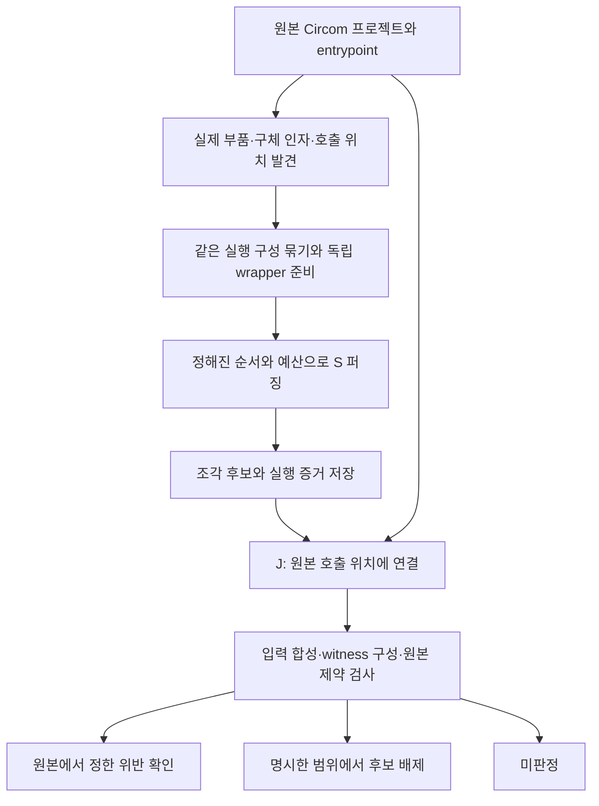

# 랭킹에서 시작해 대형 Circom 원본 반례까지: 교수님께 설명할 프로젝트 전체 흐름

2026-10-29. 기존 전체 설명에 inference의 원본 반례, W 대조, 비용의 의미와 후속 cold 실행 기록을 통합한 보강본이다. **A는 개발 세트다. 아래 A 결과는 독립 평가 성과가 아니다.** 과거 결과와 후속 결과는 구분하며, 기존 프로토콜·판정·실행 기록은 변경하지 않는다.

**우리 프로젝트의 최초 출발점은 랭킹이었어.** 처음부터 자동 분할과 J를 주제로 정해놓고 출발한 것은 아니야. 제한된 시간에 어떤 부품부터 퍼징하면 좋은지 묻다가, 그 질문을 실제 프로젝트에서 시험하는 데 필요한 시스템을 만들었고, 실험을 통해 중심 질문이 구체화됐어.

교수님께 전달할 전체 이야기는 다음 흐름이 맞아.

> **“제한된 시간에 위험한 부품부터 퍼징하도록 순위를 매기자”에서 시작했다.  
> 그 순위를 실제 프로젝트에 적용하려고 부품을 자동으로 찾아 실행하는 기반을 만들었다.  
> 실험하면서 순위의 효과와 작은 부품으로 나누는 효과를 구분해야 한다는 사실을 알게 됐다.  
> 또 작은 부품에서 나온 이상이 원래 전체 회로에서도 가능한지 확인해야 해서 J를 개발했다.  
> 지금은 이 전체 과정이 실제로 작동한다는 증거를 확보했고, 준비와 검증 비용까지 포함해 얼마나 유리한지를 평가하는 단계다.**

이제 이 흐름을, Circom이나 우리 코드를 처음 보는 사람도 이해할 수 있도록 처음부터 풀어볼게. 아래의 간단한 숫자 예시는 개념 설명용이고, 실제 실험 결과는 따로 표시할게.

그전에 **이 설명이 단지 앞으로 해보고 싶은 아이디어에 대한 이야기는 아니라는 점**을 먼저 말해두는 게 좋아. inference라는 실제 대형 개발 회로에서는, 원본 전체를 통째로 퍼징한 W가 1,236초씩 세 번 실행해 후보를 못 냈지만, 조각 탐색 S와 원본 검토 J를 연결한 경로는 **원본 제약을 통과하면서 정상 계산과 최종 출력이 다른 반례**를 얻었어. 보존한 대표 반례는 같은 최상위 입력으로 다른 최종 답이 허용된다는 것까지 확인했고, 알려진 IntDiv 출력 제약 누락에 의존한다는 수정본 대조도 있어.

후속 cold 실행 기록에서는 이전 컴파일 캐시를 재사용하지 않고 준비부터 시작해, S·J·원본 검사를 포함한 첫 원본 반례까지 **209.2초, 831.4초, 134.6초**가 기록됐어. 이 새 결과는 뒤에서 별도로 설명할게. 원인 귀속 검토는 이 시간 밖이고 실행 환경·W 비용 기준에도 정리할 문제가 남아 있으므로, 세 숫자를 곧바로 완전한 공정 비교의 속도 향상 배수로 바꾸지는 않아. [기존 원본 반례와 W 대조](</Users/miiz/Desktop/kwzzzz_zkfr/docs/n5_next_gate_2026-10-28.md>), [후속 cold 결과](</Users/miiz/Desktop/kwzzzz_zkfr/docs/n7_a_sj_cold_e2e_results_2026-10-29.md>)

**“전체 퍼징에서 탐색이 잘 진행되지 않던 큰 회로에서, 자동 조각 탐색을 실제 원본 반례까지 연결했다.”** 이것은 이미 설명할 수 있는 긍정적인 결과야. 이제부터의 이야기는 이 결과가 어떤 아이디어에서 출발했고, 무엇을 구현해야 가능했으며, 어디까지 입증한 것인지를 풀어내는 거야.

---

우선 교수님께 우리 문제를 설명하려면, **ZK 회로에서 말하는 ‘계산을 제대로 했다’가 일반 프로그램과 어떻게 다른지**부터 짚는 게 좋아.

일반 프로그램에서는 보통 입력을 넣고 프로그램을 실행해서 나온 출력을 본다. 예를 들어 곱셈 프로그램에 3과 5를 넣었을 때 15가 나오면, 적어도 그 입력에서는 정상적으로 계산했다고 볼 수 있어.

그런데 Circom으로 작성하는 ZK 프로그램에서는 두 가지를 구분해야 해.

하나는 **값을 실제로 계산하는 절차**이고, 다른 하나는 **제출된 값이 만족해야 하는 수학적 조건**이야.

계산 과정에 들어가는 입력, 중간값, 출력 등을 모아 놓은 값의 묶음을 여기서는 *witness*라고 부르면 돼. 초보자에게는 “계산 과정의 빈칸을 전부 채운 답안지”라고 설명하면 이해하기 쉽다.

제약은 그 답안지가 지켜야 하는 채점 기준이야.

예를 들어 개발자는 다음 계산을 의도할 수 있어.

```text
입력: a = 3, b = 5
출력: c = a × b = 15
```

정상 계산기는 당연히 `c=15`를 만들어. 하지만 채점 기준에 `c=a×b`라는 조건을 빠뜨렸다면, 다른 사람이 `c=999`라고 쓴 답안지를 제출해도 그 잘못을 걸러내지 못할 수 있어.

**정상 계산기가 정답을 내는 것과, 제약이 오답을 거부하는 것은 서로 다른 문제인 거야.**

Circom에서는 이 차이가 문법에도 드러나.

```circom
out <-- a * b;
```

이 문장은 witness를 계산할 때 `out`에 값을 넣지만, 그 자체로 `out=a*b`라는 제약을 추가하지 않아. 반면 다음 문장은 계산과 제약을 함께 넣는다.

```circom
out <== a * b;
```

물론 `<--`를 썼다는 사실만으로 버그는 아니야. 복잡한 값을 먼저 계산하고 별도의 제약으로 올바름을 검사하는 정상적인 사용법도 있어. 문제는 **계산한 값에 필요한 제약이 충분히 연결되어 있는가**야. [Circom 공식 제약 생성 문서](https://github.com/iden3/circom/blob/master/mkdocs/docs/circom-language/constraint-generation.md)

우리 연구가 대상으로 삼는 중요한 오류 중 하나가 이런 종류야. 개발자가 의도한 계산과, 실제 제약이 받아들이는 값 사이에 틈이 있는지 찾는 거지.

여기서 한 가지 더 구분해야 해. 원본 제약을 만족하는 이상한 witness를 찾았다는 것은 중요한 회로 수준의 증거지만, 특정 서비스에서 실제 자산을 탈취할 수 있다는 것까지 자동으로 입증하는 것은 아니야. 서비스가 외부에서 추가 입력 검사를 하는지, 그 출력이 어떤 의사결정에 쓰이는지 같은 문제는 별도로 봐야 해.

우리도 이 구분 때문에 **부품의 이상, 원본 회로에서의 확인, 응용 수준의 영향, 고유 원인**을 같은 숫자로 합치지 않으려고 하는 거야.

---

이 문제를 자동으로 찾는 기존 도구 중 하나가 **zkFuzz**야.

퍼징은 여러 입력과 실행 변형을 시도하면서 예상과 다른 동작을 찾는 방식이야. zkFuzz는 특히 witness를 만드는 계산을 변형하고, 그렇게 얻은 값이 **변경하지 않은 원래 제약**을 통과하는지 살펴봐.

정상 계산과 다른 결과인데 원래 제약이 받아들인다면, 계산과 제약 사이의 틈을 찾은 셈이야. 정상 계산의 중단과 제약 만족 사이의 불일치도 다룬다. 이 비교의 기반이 TCCT라는 개념이고, 우리가 새로 만든 정의는 아니야. [zkFuzz 원문 §III–IV](https://arxiv.org/html/2504.11961v3)

우리 프로젝트는 이 퍼저를 처음부터 다시 만드는 것으로 시작하지 않았어.

**이미 있는 zkFuzz를 어디에, 어떤 순서로, 얼마 동안 적용하면 제한된 자원을 더 잘 쓸 수 있을까?** 이게 처음의 질문이었어.

예를 들어 어떤 프로젝트 안에 분석할 부품이 100개 있다고 해보자. 그런데 주어진 시간에는 10개 정도밖에 분석할 수 없어.

그렇다면 다음 문제가 생겨.

> “그냥 파일 순서대로 10개를 돌릴까?  
> 작은 부품부터 돌릴까?  
> 정적 분석에서 수상한 신호가 많은 부품부터 돌릴까?  
> 위험해 보이면서 분석 비용도 낮은 부품을 우선할까?”

이때 **어떤 대상을 먼저 실행할지 정하는 것이 랭킹**이야.

처음 우리가 기대한 기여는 “무조건 더 오래 돌린다”가 아니라, **같은 제한 시간에서도 좋은 순서를 사용하면 검토를 통과한 결함을 더 빨리 또는 더 많이 찾을 수 있다**는 것이었어. 9월 24일 계획에도 이 주장이 연구의 핵심으로 명시되어 있어. [당시 계획](</Users/miiz/Desktop/kwzzzz_zkfr/docs/plan_revision_2026-09-24.md>)

이를 위해 실제로 여러 실행 순서를 구현했어.

| 순서 | 쉽게 말하면 |
|---|---|
| `path-order` | 정해진 경로 순서대로 실행 |
| `random` | 고정한 난수 seed로 순서를 섞어서 실행 |
| `small-first` | 제약 수가 작은 대상부터 실행 |
| `risk-only` | 정적 위험 점수가 높은 대상부터 실행 |
| `cost-aware` | 위험 점수와 대상 크기를 함께 고려해서 실행 |
| `warning-first` | 분석기 경고가 많은 대상을 우선 |

이것은 “이 부품에는 반드시 결함이 있다”는 판정이 아니야. **아직 결함 여부를 모르지만, 먼저 시간을 써볼 만한 대상을 고르는 정책**이야.

또 당시의 `cost-aware`는 실제 실행 시간을 정확히 예측하는 학습 모델이 아니었어. 제약 수를 바탕으로 대상 크기를 완만하게 반영하는 휴리스틱이었지. 따라서 구현했다는 사실과 “정말 좋은 순위인가”를 입증하는 것은 별개였어.

---

그런데 **랭킹을 실험하려면, 우선 순위를 매길 대상들이 실제로 준비되어 있어야 했어.**

여기서부터 지금까지 만든 기반이 필요해졌어.

프로젝트 폴더에 `.circom` 파일이 많다고 해서, 그 파일 하나하나를 그대로 퍼저에 넣으면 되는 게 아니야. 어떤 파일은 여러 곳에서 사용하는 부품 정의이고, 어떤 부품은 매개변수를 받아 구체적인 크기가 결정되고, 어떤 것은 프로젝트의 진입점에서 실제로 사용되지 않을 수도 있어.

예를 들어 다음 두 부품은 이름은 같아도 서로 다른 분석 대상이야.

```text
LessThan(32)
LessThan(64)
```

둘 다 비교 부품이지만 다루는 비트 폭이 달라. 같은 `LessThan(32)`라도 원본의 어느 위치에서 사용되는지에 따라 들어오는 값의 조건이 달라질 수 있어.

그래서 시스템은 적어도 다음을 알아야 했어.

- 실제 프로젝트의 진입점은 무엇인가.
- 그 진입점에서 어떤 부품을 사용하는가.
- 각 부품의 구체적인 매개변수는 무엇인가.
- 같은 구성의 부품이 어디에 몇 번 사용되는가.
- 독립적으로 실행하려면 어떤 소스와 의존 파일이 필요한가.

여기서 *entrypoint*는 “이번에 분석하려는 전체 회로의 출발점”이라고 이해하면 돼. *template*는 부품의 설계도이고, 구체 인자가 정해진 부품은 그 설계도로 실제 만들어진 구성이라고 보면 된다. *호출 위치*는 그 부품이 원본의 어디에 들어가 있는지를 뜻해.

우리는 이 정보를 자동으로 찾아서, 부품을 독립적으로 실행할 수 있는 작은 진입 코드를 만들었어. 이 진입 코드를 *wrapper*라고 불러.

쉽게 말하면 큰 기계에 붙어 있는 부품을 시험대에 올리고, 그 부품의 입력과 출력을 밖에서 연결할 수 있도록 만드는 거야.

**이 자동 발견과 wrapper 생성은 처음부터 별개의 취미 작업이었던 게 아니라, 랭킹을 실제 프로젝트에서 실행하기 위해 필요한 기반이었어.**

---

이 단계에서도 생각보다 어려운 문제가 나왔어.

Circom의 부품 매개변수는 항상 소스에 단순한 숫자로 써 있는 게 아니야. 함수 계산, 배열, 반복문 등을 거쳐 결정될 수 있어.

초기에는 우리가 만든 해석기로 이런 값을 알아내려고 했어. 그런데 Circom의 계산 의미를 별도 코드로 흉내 내다 보면 미지원 구문과 의미 차이가 생겨.

실제로 기록에는 `1 / 2`의 해석이 어긋난 사례도 있어. 일반적인 정수 나눗셈처럼 생각하면 0이 될 수 있지만, Circom의 해당 연산은 유한체에서의 나눗셈이라 의미가 달라.

이런 값을 잘못 읽으면 “컴파일되는 작은 회로”는 만들 수 있어도, **원본이 실제로 사용하던 바로 그 부품을 만든 것인지**는 틀릴 수 있어.

그래서 F-01에서는 방법을 바꿨어.

> “Circom의 계산 규칙을 우리가 전부 다시 구현하려 하지 말고, 진짜 Circom 컴파일러가 계산한 결과에서 부품의 구체 인자를 읽자.”

진단용 소스 사본에 값을 읽기 위한 캡처 제약을 넣고, 최적화하지 않은 컴파일 결과에서 그 값을 회수하는 방식을 만들었어. 실제 퍼징할 wrapper는 진단 사본이 아니라 원래 소스를 사용해.

이 부분은 단순히 파일을 잘라내는 스크립트보다 더 많은 작업이 필요했던 이유를 잘 보여줘. **어떤 부품을 시험하는지부터 정확해야 그 뒤의 랭킹과 퍼징 결과를 믿을 수 있기 때문**이야.

그 결과, 당시 production으로 분류한 656개 entrypoint에서 완전 자동 준비 성공이 **44개에서 107개로 증가**했어. 큰 회로 25개에서는 완전 준비 성공이 **1개에서 6개로 증가**했고.

이 수치는 결함 발견 수가 아니야. “전에는 분석 준비 자체가 안 됐던 원본에서, 이제 실제 부품을 자동으로 꺼내 실행 준비를 할 수 있다”는 적용성 결과야. [F-01 결과](</Users/miiz/Desktop/kwzzzz_zkfr/docs/f01_discovery_results_2026-10-03.md>)

---

또 하나는 **같은 부품을 너무 여러 번 준비하는 문제**였어.

큰 프로젝트에서는 동일한 부품 구성을 수백, 수천 군데 사용할 수 있어. 그런데 사용 위치가 다르다는 이유로 매번 같은 wrapper를 다시 컴파일하면 준비 시간부터 낭비가 커져.

그래서 우리는 다음 두 정보를 구분했어.

> “실행할 부품 구성이 같은가?”  
> “그 부품이 원본의 어느 위치에서 쓰이는가?”

부품 구성이 같으면 컴파일 결과를 재사용할 수 있어. 하지만 호출 위치 정보는 계속 보존해야 해. 나중에 각 위치에서 입력 조건이 다르다는 사실이 중요해지기 때문이야.

9월 26일 측정에서는 18개 entrypoint의 **5,240 호출 위치에 대한 컴파일을 63회로 줄였고**, 전체 준비 시간이 **164.2초에서 14.1초로 줄었어.**

이것은 실제로 측정한 구현상의 이득이야. 다만 “퍼징이 그만큼 빨라졌다”거나 “결함을 그만큼 더 찾았다”는 결과는 아니야. 해당 실험은 준비 비용을 측정했고, 퍼징은 실행하지 않았어. [컴파일 재사용 결과](</Users/miiz/Desktop/kwzzzz_zkfr/reports/t6a-compile-reuse-2026-09-26/REPORT.md>)

이렇게 자동 발견, 구체 인자 처리, wrapper 생성, 컴파일 재사용, 순위 생성, 예산 스케줄러를 만들면서 **랭킹 아이디어를 실제로 시험할 시스템**이 갖춰진 거야.

---

그다음 실제 실험을 해보니, **랭킹이 좋은지를 해석하는 데 문제가 있다는 사실이 드러났어.**

첫 번째 문제는 실험 대상이 적거나 빨리 끝나서, 정해진 시간 안에 거의 모든 부품을 실행해버리는 경우였어.

예를 들어 분석할 부품이 3개이고 시간 안에 3개를 전부 실행한다면, 어떤 순서를 쓰더라도 최종적으로 검사한 대상은 같아질 수 있지.

이 경우에도 첫 발견까지 걸린 시간은 달라질 수 있어. 하지만 “좋은 순위 덕분에 제한된 예산에서 더 많은 대상을 찾아냈다”는 효과를 보기는 어려워져.

두 번째 문제는 **위험 점수가 실제 결함 유무를 충분히 구분하지 못하는 경우**였어.

취약한 버전과 수정한 버전이 제약 한두 줄 차이라면, 정적 특징과 위험 점수가 같을 수 있어. 실제 v3 파일럿에서는 취약본과 수정본의 점수가 동점이었고, 동점 처리 순서 때문에 수정본이 먼저 실행됐어.

그 실험은 알려진 결함을 재발견하는 데는 성공했지만, 위험 점수가 좋은 순위를 만든다는 증거는 되지 못했어. [v3 결과](</Users/miiz/Desktop/kwzzzz_zkfr/reports/controlled-v3-pilot-2026-09-23/REPORT.md>)

세 번째 문제는 **실험용으로 넣은 결함이 랭킹에 쓰는 특징까지 바꾸는 것**이었어.

우리가 `<==`를 `<--`로 바꿔 결함을 만들었다고 해보자. 그러면 제약이 빠지는 동시에 정적 분석기가 수상하게 보는 특징도 늘어날 수 있어.

그 결과 위험 기반 순위가 그 부품을 앞으로 끌어올렸다면, 이를 곧바로 “실제 프로젝트에서도 우리 순위가 우수하다”라고 해석하기 어려워. 실험용 결함을 만드는 방식이 특정 순위 전략에 유리한 조건을 만든 것이기 때문이야.

실제 9월 27일 파일럿에서는 주입한 `Where` 결함 때문에 위험 점수가 올라가고, `cost-aware` 순위가 14위에서 2위로 바뀌었어. 45회 실행 가운데 27회는 모든 타깃을 시작해서, 예산 때문에 일부 대상만 선택하는 상황도 충분히 만들어지지 않았고. [순위 파일럿](</Users/miiz/Desktop/kwzzzz_zkfr/reports/dev-ranking-pilot-2026-09-27/README.md>)

이 결과에서 내려야 하는 결론은 정확히 이거야.

**“랭킹은 쓸모없다”가 아니라, “우리가 구현한 랭킹의 일반적인 우위를 현재 실험으로 입증하지 못했다.”**

이 차이는 교수님께 설명할 때 중요해. 원래 가설을 숨기는 것도 아니고, 반대로 증명되지 않은 가설을 성공한 것처럼 유지하는 것도 아니야. 실제 실험에서 무엇이 분리되지 않았는지 설명하는 거지.

---

동시에 이 실험 과정에서 **랭킹보다 앞단에 있는 큰 효과**가 보였어.

같은 종류의 작은 부품은 따로 꺼내면 빠르게 탐색할 수 있는데, 큰 원본 전체에 넣으면 한 번 탐색하는 비용부터 매우 커진다는 점이야.

당시 개발용 `Where` 주입 사례에서는 작은 부품 실행에서 매우 빠르게 후보를 찾았지만, 전체 회로 실행은 30분 동안 몇 세대만 진행하고 후보를 찾지 못했어.

다만 이 초기 비교는 동시 실행과 seed 등 조건 차이가 있었고 주입 사례였으므로, 정확한 속도 향상 배수를 주장하는 근거로 쓰면 안 돼. 대신 **큰 회로에서는 퍼저의 탐색 한 번 자체가 비싸다는 병목을 관찰한 개발 진단**으로 설명할 수 있어.

여기서 연구 질문이 더 구체적으로 나뉘게 된 거야.

> “좋은 순서가 효과를 내는가?”와 별개로,  
> **“실제 프로젝트에서 작은 분석 단위를 자동으로 만들면 통째 분석보다 탐색이 가능해지는가?”**

순위가 아무리 좋아도 실행할 대상 자체가 준비되지 않으면 소용이 없어. 그리고 작은 단위로 만드는 효과가 크다면, 먼저 그 효과를 검증하고 그 위에서 순위의 추가 효과를 따져야 해.

그래서 10월 1일 계획에서는 자동 분해의 적용성, 검토된 결과, 원본 맥락, 총비용을 중심 질문으로 두고 랭킹을 보조 질문으로 내렸어. **랭킹에서 시작해 만든 기반을 활용하면서, 무엇이 실제 효과의 원천인지 더 엄격하게 묻게 된 것**이야. [방향 변경 기록](</Users/miiz/Desktop/kwzzzz_zkfr/docs/plan_revision_2026-10-01.md>)

---

이후 이야기를 이해하려면 우리가 쓰는 W, S, J를 구분하면 편해.

| 이름 | 하는 일 | 쉬운 설명 |
|---|---|---|
| **W** | 원본 entrypoint 전체에 zkFuzz를 적용 | 큰 기계를 통째로 시험 |
| **S** | 자동으로 구성한 조각들에 zkFuzz를 적용 | 실제 부품을 시험대에 올려 따로 시험 |
| **J** | 조각 후보를 원본 호출 위치와 전체 제약에서 검토 | 그 부품의 이상이 실제 조립된 기계에서도 가능한지 확인 |

S는 새로운 퍼징 엔진을 처음부터 만든 것이 아니야. **기존 zkFuzz가 분석할 단위를 자동으로 구성하고 실행을 관리하는 쪽**이야.

따라서 우리가 비교하려는 것은 기본적으로 **W 대 S+J**야. 한쪽은 큰 회로를 직접 탐색하고, 다른 쪽은 작은 회로를 탐색한 다음 그 결과를 원본으로 연결하는 거지. 조각 퍼징 S만의 빠른 시간과 W의 전체 시간을 비교하면, S 쪽의 중요한 후처리 비용을 숨기게 돼.

J도 “안전/위험을 무조건 답하는 만능 검증기”는 아니야. 후보를 원본에 연결하려고 시도하고, 확보한 근거에 따라 확인·배제·미판정을 구분하는 검토기야.

전체 연결은 이렇게 볼 수 있어.



이 구조가 커진 이유는 기능을 많이 붙이고 싶어서가 아니라, **조각에서 발견한 결과를 실제 프로젝트의 결과로 해석하려면 추가 질문에 답해야 했기 때문**이야.

여기서 **J는 S의 후보가 생긴 다음에 붙는 단계**가 맞아. 다만 모든 퍼징을 끝낼 때까지 기다려야 하는 것은 아니야. 후보 하나가 저장되면 그 후보를 바로 J에 보내고, 판정에 쓴 시간만큼 남은 탐색 시간을 줄일 수도 있어. 기존의 “S를 끝까지 돌린 뒤 J 요청을 순서대로 처리”하는 구조와 최근의 “후보가 나오면 곧바로 J” 구조는 같은 기능을 호출하더라도 첫 원본 반례까지의 시간이 달라질 수 있어.

또 **W는 검증이 필요 없고 S만 검증이 필요하다는 뜻은 아니야.** zkFuzz 자체의 오라클도 변형 witness와 제약의 관계를 검사해. W에서는 그 대상이 원본 전체이고, S에서는 떼어낸 부품이야. 따라서 S의 검사를 통과했다는 것만으로는 원본 전체의 제약까지 통과했다고 할 수 없어.

| 질문 | W: 원본 전체 퍼징 | S+J: 조각 퍼징과 원본 검토 |
|---|---|---|
| 퍼저가 직접 검사하는 대상은? | 원본 entrypoint | 독립 wrapper로 만든 부품 |
| 조각화로 사라진 호출자 조건을 다시 확인해야 하나? | 조각화하지 않았으므로 그 복원 문제는 통상 생기지 않음 | 필요함. 이것이 J의 핵심 역할 |
| 최종 성과로 세기 전 원본 증거 확인은? | 필요함 | 필요함 |
| 반복 후보의 고유 원인 구분과 응용 해석은? | 별도로 필요함 | 별도로 필요함 |

쉽게 비용을 적으면 다음과 같아.

```text
W 비용   = 원본 준비·컴파일 + 전체 탐색 + 공통 최종 검증
S+J 비용 = 원본 및 조각 준비·컴파일 + 조각 탐색 + 호출 맥락 연결 + 공통 최종 검증
```

여기서 ‘공통 최종 검증’은 양쪽에 같은 종류의 증거를 요구한다는 뜻이지, 반드시 같은 코드 경로를 억지로 통과시키겠다는 뜻은 아니야. W가 이미 전체 witness를 만들었다면 그것을 재생·검사하면 돼. S에만 필요한 역방향 입력 합성을 W에도 불필요하게 시켜서 W 시간을 늘리면 공정한 비교가 아니지. 내부 오라클에서 이미 쓴 검증 시간과 외부 재검증 시간도 실제로 실행한 대로 구분해서 기록해야 해.

우리에게 필요한 이득은 **작게 나눠 탐색해서 아낀 시간이나 늘어난 발견 가능성이, 원본 맥락을 복원하고 검증하는 추가 비용보다 충분히 큰가**야. 이 조건은 당연히 성립하는 것이 아니라 실험으로 확인해야 해.

---

그 추가 질문의 출발점은 **조각을 떼어내면 원래 주변 조건이 사라질 수 있다**는 것이었어.

개념 설명용으로 어떤 부품이 입력 `x`를 받는다고 해보자. 부품만 따로 실행하면 `x=2`를 자유롭게 넣을 수 있어.

그런데 원래 프로젝트에서는 그 입력에 다음 조건이 붙어 있다고 하자.

```text
x는 반드시 0 또는 1이어야 한다.
```

그렇다면 조각 퍼징에서 `x=2`일 때 이상한 결과를 찾았더라도, 그 후보는 원래 프로젝트에서는 발생할 수 없어.

부품을 독립적으로 분석한 결과가 틀렸다는 뜻은 아니야. **분리된 부품에서 가능한 상황과 특정 원본 호출 위치에서 가능한 상황의 범위가 다르다는 뜻**이야.

실제로 초기 개발 과정의 zk-email 사례에서도, 분리한 비교 부품에서는 문제가 되는 값이 나오지만 원래 호출자의 범위 제약이 그 값을 막는 경우를 확인했어.

이 문제를 무시하면 다음과 같은 잘못된 결론이 나와.

> “분할하니 후보가 100개 나왔다. 통째 분석은 0개였다. 따라서 100개 버그를 더 찾았다.”

그런데 그 100개가 원본에서 불가능한 입력에 의존한다면 프로젝트 수준의 이득이라고 할 수 없지.

그래서 **S가 후보를 만드는 단계와 J가 원본에서 검토하는 단계를 분리**하게 된 거야.

---

J가 처음 하는 일은 **후보가 어느 부품의 어느 호출 위치에 해당하는지 정확히 찾는 것**이야.

같은 부품 구성이 여러 위치에서 사용될 수 있으므로, 컴파일 결과는 재사용하더라도 원본 맥락은 따로 봐야 해.

예를 들어 같은 비교 부품이 두 곳에 있다고 해보자.

```text
위치 A: 입력 앞에 범위 검사가 있음
위치 B: 입력 앞에 범위 검사가 없음
```

부품 자체는 같지만 같은 후보에 대한 원본 판정은 달라질 수 있어.

그다음 J는 후보의 입력이 원본에서 어떻게 만들어지는지 살펴봐.

단순한 경우에는 원본 입력과 바로 연결되어 있어. 그러면 값을 대응시키기 쉽다.

상수와 연결된 경우도 있어. 원본에서는 항상 0이 들어가는데 후보는 5를 요구한다면, 그 정확한 후보는 해당 위치에서 불가능하다는 근거가 될 수 있어.

어려운 경우는 **부품 입력이 다른 계산의 결과인 경우**야.

설명용으로 다음 관계를 보자.

```text
부품 입력 = 최상위 입력 + 2
```

S가 부품 입력이 5일 때 후보를 찾았다면, J는 최상위 입력을 3으로 하면 되는지 확인할 수 있어.

하지만 실제 회로에서는 부품 입력이 여러 단계의 산술, 비교, 비트 분해, 암호 연산을 거쳐 만들어질 수 있어. 하나의 상위 입력이 여러 부품에 동시에 영향을 줄 수도 있고.

따라서 “부품 입력을 5로 바꾼다”는 것만으로는 부족해. **원본의 다른 관계도 모두 만족하면서 그 위치에 5가 들어가도록 전체 값을 구성해야 해.**

우리가 상위 입력 탐색이나 역방향 합성이라고 부르는 부분이 이거야. [초기 J 합성 설계와 결과](</Users/miiz/Desktop/kwzzzz_zkfr/docs/lifting_synthesis_results_2026-10-02.md>)

---

이때 사용하는 solver는 쉽게 말하면 **여러 방정식과 조건을 동시에 만족하는 값을 찾는 도구**야.

하지만 원본 회로 전체의 모든 변수를 처음부터 자유롭게 두고 풀면 너무 어려울 수 있어. 그래서 기존 J는 목표와 관련된 작은 제약 묶음을 먼저 보고, 기준 witness의 값을 활용하면서 후보를 실현할 값을 찾으려고 해.

이것이 “작은 부분 풀이”나 “관련 제약 원뿔” 같은 표현의 뜻이야. 목표 신호와 관계된 부분을 따라가며 필요한 조건을 모으는 거지.

여기서 주의할 점이 생겨.

탐색을 쉽게 하려고 일부 값을 기준 witness의 값으로 임시 고정했는데 그 문제에 해가 없다고 나오더라도, **원본 전체에 해가 없다는 뜻은 아니야.** 다른 값을 허용하면 해가 생길 수 있으니까.

따라서 J는 다음 둘을 구분해야 해.

> 원본 제약이 실제로 강제하는 값 때문에 불가능한 경우.  
> 탐색 편의를 위해 고정한 값 때문에 현재 시도만 막힌 경우.

전자는 적절한 범위의 배제 근거가 될 수 있어. 후자는 일반적으로 미판정이나 다음 탐색의 이유야.

또 solver가 시간 안에 답을 못 냈다고 해서 해가 없다는 뜻도 아니야.

- `SAT`: 해당 질의에 해를 찾음.
- `UNSAT`: 해당 질의의 조건들을 동시에 만족하는 해가 없음을 확인.
- `unknown` 또는 timeout: 이 방식과 예산으로 결론을 얻지 못함.

**질의에 무엇을 고정했는지까지 함께 봐야 이 결과를 올바르게 해석할 수 있어.**

이 때문에 우리가 unknown을 쉽게 없애지 못하는 거야. 미판정을 억지로 배제나 안전으로 바꾸면 숫자는 좋아지지만 판정 의미가 틀어져.

---

또 **solver가 작은 부분의 답을 찾았다고 바로 원본 반례가 되는 것도 아니야.**

그 값을 실제 witness에 넣으면 주변의 다른 제약이 깨질 수 있어. 또는 witness 생성기가 값을 다시 계산하면서 solver가 제안한 값을 덮어쓸 수 있어.

기존 J의 수리 기능은 이런 상황에서 실패한 제약과 관련 부품을 찾아, 추가로 맞춰야 할 값들을 다시 탐색하는 방식이야.

여기서 말하는 수리는 프로젝트의 결함을 고치는 것이 아니야. **후보를 담으려는 witness에서 다른 조건도 함께 만족시키기 위한 탐색**이야.

예를 들어 한 부품의 출력을 바꾸자 다음 부품의 범위 검사에서 실패한다면, 어느 입력과 중간값을 함께 바꿔야 하는지 다시 살펴보는 거지.

하지만 이 과정은 항상 수렴하지 않아. 한 조건을 맞추면 다른 조건이 깨지고, 다시 고치면 앞의 조건으로 돌아오는 순환도 생길 수 있어. 암호 연산처럼 역으로 입력을 찾기 어려운 관계도 있어.

그래서 최종 승인 단계가 중요해.

**J가 제안한 값은 결국 변경하지 않은 원본 제약 전체를 통과해야 해.**

이를 위해 Rust 평가 경로와 snarkjs 검사를 사용하고, 후보가 목표 위치에 실제 적용됐는지도 확인해. 지역 제약만 맞거나, 주입이 적용되지 않았거나, 원본 검사에 실패하면 원본에서 확인된 결과로 세지 않아.

---

이 과정을 이해하려면 우리가 자주 말하는 O0, O1, R1CS, SYM도 간단히 설명해두는 게 좋아.

| 용어 | 쉬운 뜻 |
|---|---|
| **R1CS** | 회로가 만족해야 하는 제약들을 컴파일한 수학적 형식 |
| **witness / `.wtns`** | 제약에 넣어 검사할 입력·중간값·출력의 값 묶음 |
| **SYM** | 신호 이름과 컴파일된 번호를 연결하는 대응 정보 |
| **O0** | 단순화하지 않은 컴파일 결과 |
| **O1** | 일부 신호 대응과 상수 등을 단순화한 컴파일 결과 |

같은 소스라도 O0와 O1의 제약 수와 wire 번호는 달라질 수 있어. 따라서 한쪽에서 얻은 값을 다른 쪽에 그냥 같은 번호로 넣으면 안 돼.

신호와 별칭, 입력이 어떻게 대응되는지 확인해야 해. 대응이 빠졌는데 임의로 0을 넣고 “검증됐다”고 하면 안 되고, 그 경우에는 미판정으로 남겨야 해.

또 원본 R1CS의 해시를 남기는 이유도 있어.

“어떤 원본 제약에 대해 이 witness가 통과했는가”를 정확히 고정하려는 거야. 나중에 소스나 컴파일 옵션이 바뀌어도, 과거 결과가 어떤 파일에 대한 결과였는지 확인할 수 있도록 하는 거지.

다만 검사기 두 개를 사용했다는 사실 자체가 새 연구 알고리즘은 아니야. **잘못된 후보를 성공으로 세지 않도록 하는 구현 신뢰성과 재현성의 장치**로 보는 게 맞아.

---

원본 제약 검사를 통과한 뒤에도 **무엇이 확인된 것인지**를 나눠야 해.

예를 들어 내부 부품의 출력이 바뀌었지만 최상위에서는 그 값을 쓰지 않을 수 있어. 어떤 조건에서는 그 값에 0을 곱하거나 다른 분기를 선택해 최종 출력이 같을 수도 있지.

그러면 “내부에서 다른 값이 가능하다”는 사실과 “전체 프로그램의 관찰 결과가 바뀐다”는 사실은 달라.

우리 결과를 설명할 때는 다음처럼 층을 나누는 게 좋아.

| 확인한 내용 | 말할 수 있는 것 | 아직 자동으로 따라오지 않는 것 |
|---|---|---|
| 조각에서 이상 후보 발견 | 그 조각의 오라클이 이상을 포착함 | 원본에서 발생 가능함 |
| 후보 입력의 원본 도달 | 그 위치에 해당 입력을 만들 수 있음 | 정한 위반이 실제로 성립함 |
| 원본에서 위반 술어 도달 | 명시한 부품 속성이 원본에서 깨질 수 있음 | 모든 경우에 최상위 출력이 바뀜 |
| 원본 제약 만족과 최상위 TCCT 위반 | 명시한 원본 관찰 관계의 위반을 확인함 | 응용 공격과 독립된 고유 원인까지 확정 |
| 특정 후보 배제 | 명시한 범위에서 그 후보가 불가능함 | 다른 후보나 같은 종류의 오류도 전부 불가능함 |

정상 계산이 실제 assert 실패 등으로 중단되는데, 다른 witness는 원본 제약을 만족하는 경우도 구분해서 다뤄. 반면 도구 오류, 입력 파일 오류, 시간 초과는 정상 계산의 의미 있는 중단과 같게 취급하면 안 돼.

그리고 보고서에서 사용하는 L1이라는 분류도 그냥 “버그 개수”로 읽으면 안 돼. 그 안의 구체 판정 유형과 입력 계약, 검증 범위를 함께 봐야 해.

---

J가 발전하면서 중요해진 또 다른 구분은 **“이 정확한 후보가 가능한가”와 “같은 종류의 위반이 가능한가”**야.

앞의 가상 예시를 다시 보자.

원본에서 `x`는 0 또는 1만 가능하고, S는 `x=2`일 때 이상한 출력을 찾았다고 하자.

J가 `x=2`는 불가능하다고 확인하면, 그 정확한 후보를 배제한 것은 맞아.

그런데 `x=1`에서도 같은 종류의 잘못된 출력이 가능할 수 있지. 그러면 첫 후보를 배제했다고 해서 부품이 안전해진 것은 아니야.

두 질문을 식으로 표현하면 대략 이렇다.

```text
정확 후보 질문:
원본에서 x=2이고, 후보가 지정한 값들이 그대로 성립하는가?

위반 술어 질문:
원본에서 어떤 x에 대해, 부품 출력이 정한 올바른 관계를 위반하는가?
```

두 번째 질문에서 “올바른 관계를 위반한다”는 조건을 *위반 술어*라고 부르는 거야.

이 구분은 최근에 처음 떠올린 것이 아니라, 초기 J의 `LessThan` 경로에서도 이미 구현했어. 실제 개발 사례 중에는 정확한 후보값은 상수와 충돌해 배제되지만, 다른 값으로 같은 비교 위반에 도달한 경우가 있었어. [L-05 결과](</Users/miiz/Desktop/kwzzzz_zkfr/docs/lifting_l05_results_2026-10-03.md>)

다만 모든 부품에 대해 이 술어를 자동으로 만들 수 있는 것은 아니야.

참조 계산이 무엇인지, 정상 계산이 실패하는 입력은 어떻게 다룰지, 부품 입력의 허용 범위가 무엇인지 등을 정확히 정해야 해. 이 부분을 대충 일반화하면 우리가 원래 찾으려던 오류와 다른 것을 찾게 될 수 있어.

---

**J의 초기 개발에는 실제로 확인된 양성 결과와 배제 결과가 있어.**

예를 들어 당시 개발 자료에서는 Banyan의 보존 후보 36개에 대해 위반 도달을 확인했고, zk-email의 특정 `rsa-test` entrypoint에 대한 후보 9개는 호출자의 범위 제약 때문에 배제했어.

이것은 “같은 도구가 어떤 후보는 원본에 연결하고, 어떤 후보는 주변 제약 때문에 배제하는 경로를 실제로 수행했다”는 증거야.

하지만 숫자를 정확히 읽어야 해.

36개는 독립된 버그 36개가 아니고, 9개도 서로 다른 원인 9개라는 뜻이 아니야. 같은 위치나 메커니즘에서 반복된 후보가 들어 있어. 답을 알고 있던 개발 자료이므로 독립 평가의 성능 추정으로 쓰지도 않아.

초기 수리 기능을 추가하면서 특정 A 개발 자료의 미판정 클래스가 28개에서 18개로 줄어든 기록도 있어. 동시에 진단과 재컴파일 때문에 비용은 증가했어.

따라서 **J는 처음부터 아무것도 못 했던 기능이 아니야.** 이미 작동한 경로와 한계가 있었고, 최근 보강은 그 이후 더 어려운 미판정을 줄여보려는 시도였어.

---

현재 교수님께 보여줄 가장 분명한 실제 양성 사례는 **inference 원본 회로에서 얻은 동일 입력의 두 witness**야.

여기서 inference는 현재 설명하는 **한 실제 개발 회로**를 가리켜. inference라는 이름 아래 모든 프로젝트나 데이터셋에서 일반적으로 성공했다는 말은 아니야. 교수님께는 이 회로를 대표 사례로 먼저 설명하고, 여러 대상에 대한 일반 성능은 다른 평가 문제로 남겨두면 돼.

이 사례를 단순히 “후보를 하나 냈다”로 축소해서 말할 필요는 없어. 실제로 중요한 다음 연결을 확인했기 때문이야.

```text
큰 원본에서 실제 부품과 호출 위치를 찾음
    → 작은 부품을 zkFuzz로 퍼징해 이상 후보를 얻음
    → J가 원본에서 그 부품 입력을 만드는 상위 입력을 찾음
    → 주변 계산과 원본 전체 제약을 함께 만족하는 witness를 구성함
    → 같은 최상위 입력의 정상 witness와 비교함
    → 원본 제약은 둘 다 통과하지만 최종 출력이 다름을 확인함
    → 보존 witness가 특정 제약을 추가한 수정본에서는 거부됨을 확인함
```

앞부분만 성공하면 조각 탐색 결과이고, 원본 검사까지 성공하면 실제 회로 반례야. 마지막 수정 대조는 그 보존 반례가 어떤 제약 누락에 의존하는지 설명하는 근거야. 세 층을 구분하면서도, **이 사례에서는 실제로 원본 반례까지 갔다는 점을 분명히 강조해야 해.**

이 회로는 최적화된 O1 기준으로 **196,096개 제약**, 단순화하지 않은 O0 기준으로 **401,664개 제약**을 가져.

둘은 서로 다른 프로젝트 크기를 말하는 것이 아니라, 같은 원본의 다른 컴파일 표현이야. 과거 문서에서 이 둘을 혼동한 부분은 이후 감사에서 바로잡았어.

이 대표 사례의 호출 위치는 `main.response_time_normalized_fn[0].division`이야. 여기서 `IntDiv`가 받는 두 입력은 부모의 `Subtract` 출력으로 계산돼. 최상위 입력을 그냥 복사해 부품에 넣는 경우가 아니었어.

따라서 “S가 찾은 값을 원본 입력에 그대로 써넣었다”로 설명하면 J가 실제 한 일을 놓쳐. **부모 계산을 거친 뒤 그 부품에 필요한 값이 도착하도록 최상위 입력을 구성하고, 다른 조건들도 동시에 만족시키는 과정**이 있었어. 기록에는 입력 합성 경로 `synthesized_a`와 두 차례 합성 라운드가 남아 있어.

J는 그 입력 관계를 연결하고 원본 witness를 구성했어. 이후 보존된 결과와 재생한 정상 witness를 비교해서 다음을 확인했지.

- 두 witness의 최상위 입력 wire **2,825개가 모두 같음**.
- 두 witness가 모두 원본 O0의 **401,664개 제약을 만족**함.
- 원본 검사와 snarkjs 검사를 통과함.
- 그런데 최상위 출력 wire 하나가 다름.

초보자에게는 이렇게 설명하면 돼.

> “같은 문제와 같은 입력을 줬는데, 서로 다른 최종 답 두 개가 모두 원본 채점 기준을 통과했습니다. 따라서 이 사례에서는 원본 제약이 의도한 답을 하나로 묶어두지 못한다는 구체적인 증거를 얻었습니다.”

이것은 단순히 조각에서 경고가 떴다는 것보다 훨씬 강한 결과야. **조각 탐색의 결과를 원본의 실제 제약을 만족하는 반례로 연결했다**는 의미가 있어.

다만 이 사례에서 모든 입력 wire가 같음을 따로 확인한 사실을, J의 모든 구현 경로가 항상 똑같은 검사를 한다는 일반 보장으로 확대하면 안 돼. 여기서는 해당 원본 반례 쌍을 추가로 감사한 결과야. [원본 반례 쌍 검증](</Users/miiz/Desktop/kwzzzz_zkfr/docs/n5_next_gate_2026-10-28.md>)

---

이 반례의 원인이 무엇인지도 따로 확인했어.

해당 IntDiv 코드에는 계산한 몫을 출력에 넣는 다음 문장이 있었어.

```circom
out <-- quot;
```

별도 수정 사본에서는 이 한 줄만 다음처럼 바꿨어.

```circom
out <== quot;
```

이렇게 하면 출력이 몫과 같아야 한다는 제약이 추가돼.

보존해둔 원본의 **이탈 witness**를 이 수정본에도 넣어 검사했어. 그러자 원본에서는 통과하던 이탈 witness들이 새로 추가된 `out=quot` 제약에서 거부됐어. 동일 입력 반례 쌍의 정상 witness까지 거부됐다는 뜻은 아니야.

이것을 *반사실 대조*라고 설명할 수 있어.

> “이 조건이 빠져 있어서 가능했던 결과라면, 그 조건만 추가했을 때 같은 결과는 막혀야 한다.”

이 실험은 특정 witness가 해당 제약 누락에 의존한다는 근거를 줘.

여기서도 조심할 부분이 있어. **수정본에서 새 탐색이 후보를 못 찾았다는 것보다, 같은 보존 witness가 추가된 정확한 제약 때문에 거부됐다는 것이 더 직접적인 근거**야.

그리고 하나의 제약 누락이 여러 호출 위치와 여러 seed에서 반복적으로 드러날 수 있으므로, 후보 개수를 그대로 독립 원인 수로 세면 안 돼.

실제 감사에서 TCCT 양성 5요청의 보존 증인은 IntDiv 출력 제약 누락이라는 한 메커니즘으로 연결됐어. 별도 술어 후보들에서는 저장된 witness의 IntDiv 의존성을 확인했어. 다른 입력으로도 위반에 도달하는지에 대해서는 RTN·Scoring은 미판정이고, DFS는 아래의 별도 양성 진단이 있어. [원인 귀속 감사](</Users/miiz/Desktop/kwzzzz_zkfr/docs/rq1_inference_causal_review_2026-10-28.md>)

DFS(`DistanceFromScore`)에서는 별도의 기존 L-06 입력을 사용했을 때 **IntDiv 한 줄 수정 후에도 비교 위반이 유지**됐어. 유한체의 소수 크기를 `p`라고 하면, 비교 입력 `(p−1, 4)`에 대해 정수 비교로는 거짓인 관계를 부품이 참으로 내놓는 사례야. IntDiv를 수정한 회로에서도 같은 입력의 정상 witness가 제약을 통과했고, DFS 입력에 필요한 40비트 범위 조건을 추가했을 때는 그 입력이 막혔어.

따라서 이 개발 회로에서 IntDiv의 출력 등식 누락과 별개로 **입력 범위 누락에 따른 의미 위반**도 확인한 셈이야. 이것은 긍정적인 부가 진단이지만, 같은 입력에서 출력이 두 개가 되는 반례와는 속성이 달라. 또한 이 입력은 앞의 N6 대표 후보가 만든 것이 아니므로 N6가 두 번째 고유 원인을 새로 찾았다고 더하지 않아. 외부에서 입력을 40비트로 검사한다면 서비스에서의 영향도 달라질 수 있어.

이 작업이 필요한 이유는 “경고 43개” 같은 숫자를 “버그 43개”로 부풀리지 않기 위해서야. 원본 반례를 확보하는 것과 고유한 소스 원인을 세는 것은 다른 단계야.

**이미 알려진 결함을 찾았다는 이유로 이 결과가 무의미해지는 것은 아니야.** 여기서 평가하려는 것은 “처음 보는 결함을 제보했는가”만이 아니라, 큰 원본에서 자동 탐색과 맥락 검토가 실제 유효한 반례에 도달할 수 있는가이기도 해. 알려진 결함은 답이 있는 양성 사례이므로 그 경로가 작동하는지 확인하는 데 유용해.

다만 두 기여를 섞으면 안 돼. **새로운 취약점 발견**은 아직 이 사례의 성과가 아니고, **기존 전체 탐색이 정한 시간에 후보를 못 만든 대형 원본에서 자동 조각 탐색과 J가 알려진 결함의 유효 반례를 구성했다**는 것은 이 사례의 성과야. 입력을 수작업으로 맞춰준 것인지, 부품을 결과를 본 뒤 고른 것인지, 자동 발견과 순서 정책으로 찾은 것인지도 함께 설명해야 해.

현재의 A 회로 자체는 결과를 본 뒤 대표 사례로 골랐어. 그래서 선택 편향은 있어. 그래도 보존된 witness가 원본을 통과한다는 사실은 바뀌지 않아. 선택 편향이 제한하는 것은 주로 “다른 회로에서도 얼마나 잘될 것인가”라는 일반화야.

또 한 줄 수정으로 이 보존 witness가 막혔다는 사실이 수정본 전체의 안전성을 증명하지는 않아. 여기서는 **이 반례에 대해 원인 설명을 직접 시험했다**고 말하면 충분해. 이미 확보한 강한 증거와 아직 하지 않은 전체 안전 증명을 혼동할 이유가 없어.

---

자동 준비 쪽에서도 최근에 실제 대형 원본에서 확인한 결과가 있어.

inference 원본에서 **2,336개의 호출 위치를 발견하고, 실행할 조각 22개를 자동으로 준비**했어. 해당 준비 경로의 시간은 약 **7.40초**였어.

2,336개를 22개로 만들었다는 것은 결함을 압축했다는 뜻이 아니야. 원본의 많은 구체 호출을 보고, 실행 구성을 묶어 퍼징할 단위를 만든 규모를 뜻해.

같은 부품 구성이 여러 위치에서 반복되면 실행 준비를 공유할 수 있지만, 원본에서 어느 위치에 있었는지는 따로 남긴다는 앞의 설계가 여기에도 적용돼.

이 22개는 이전 조각 집합과도 소스·구체 인자·wrapper 등을 대조했어. 대상 집합의 대응은 확인했지만 일부 순서가 바뀌었으므로, 새 순서의 퍼징 성과까지 이전과 같다고 선언하지는 않았어.

또 7.40초는 이 준비 단계의 실측이지, 모든 퍼징과 J 검증까지 끝난 시간이 아니야. [자동 준비 결과](</Users/miiz/Desktop/kwzzzz_zkfr/docs/n7_a_feasibility_results_2026-10-29.md>), [후속 대상 대응 확인](</Users/miiz/Desktop/kwzzzz_zkfr/docs/contribution_brief_2026-10-29_v4.md>)

---

그렇다면 **전체 회로에 zkFuzz를 직접 돌린 결과는 어땠는가**도 보여줘야 해.

같은 inference 개발 회로에 대해, W를 seed 세 개로 각각 약 **1,236초** 실행한 추가 기록이 있어. 세 실행 모두 후보가 없었어.

이것은 자동 조각 탐색에 유리한 개발 관측이야. 원본 반례까지 연결된 S+J 사례가 있는 반면, 이 W 실행에서는 후보가 나오지 않았으니까.

이것은 **W가 후보를 내지 못한 같은 회로에서 S+J는 원본 반례까지 얻은 사례가 존재한다**는 점을 보여줘. W의 후보 0을 원본 안전으로 해석해서도 안 되고, 반대로 S+J의 원본 검증 성공을 “아무 결과도 없다”고 해석해서도 안 돼.

다만 **이 기존 기록만으로** 곧바로 “S+J가 같은 비용에서 이겼다”고 말할 수는 없었어. 후속 cold 실험과 구분해서 설명해야 해.

기존 S는 조각 퍼징에 시간을 썼고, 그 뒤 J가 후보들을 검토하는 데 추가 시간이 들어갔어. 준비, 컴파일, 후보 요청 생성, 검증, 사람 검토도 비용이지.

특히 위에서 설명한 계산된 입력의 원본 반례 사례는 기존 순차 실행 순서를 반영하면 약 **1,294초에 준비 비용이 추가**돼. 따라서 그 특정 사례를 “S+J는 1,236초 안에 찾았는데 W만 못 찾았다”고 설명하면 틀려.

**기존 실행에 대한** 정확한 설명은 다음이야.

> “사후 선택한 대형 개발 회로에서, 자동 조각 퍼징과 J는 원본 반례를 확보했습니다. 통째 zkFuzz의 별도 연장 실행은 세 seed 모두 후보를 만들지 못했습니다. 다만 이 당시 기록만으로는 모든 준비·검토 비용과 seed별 조건을 맞춘 비교가 완성되지 않았습니다.”

이렇게 말해도 양성 결과의 의미는 남아 있어. **실제 원본 반례를 얻은 사실**과 **일반적인 비용 우위를 아직 입증하지 않은 사실**을 함께 설명하는 거야.

그 뒤 **준비부터 첫 원본 검증 반례까지 한 시계로 잰 cold 실행**이 추가됐어. 이것은 앞의 약 1,294초를 사후에 다시 계산한 숫자가 아니라, 별도 새 실행의 기록이야.

실행은 원본 소스를 새 폴더에 복사하는 시점부터 시간을 재고, 원본 컴파일과 기준 witness 확인, 자동 조각 발견과 준비, 조각 컴파일, 퍼징, 후보별 J, 원본 검사를 포함해. 이전 컴파일 캐시는 재사용하지 않았어. 후보가 저장되면 J로 바로 넘기고, J에 쓴 시간도 같은 절대 상한에서 빠져. 원본 반례가 확인되면 나머지를 전부 돌리지 않고 멈춰.

| seed | cold 시작부터 첫 원본 검증 반례까지 | 보고된 준비 시간 | 후보가 나온 조각 | 원본 검사와 판정 |
|---|---:|---:|---|---|
| 2026100601 | **209.2초** | 34.0초 | `Subtract` | Rust 불만족 0, snarkjs 통과, `output_differs` |
| 2026100602 | **831.4초** | 33.4초 | `IntDiv(40)` | Rust 불만족 0, snarkjs 통과, `output_differs` |
| 2026100603 | **134.6초** | 33.2초 | `Subtract` | Rust 불만족 0, snarkjs 통과, `output_differs` |

세 실행에서 J가 사용한 원본 O0의 SHA는 각각 새로 컴파일한 **401,664제약 원본**과 일치했어. 별도의 과거 W 연장 실행은 같은 seed마다 약 1,236초에 후보 0이었지. **S+J의 준비·컴파일·판정 비용을 빼야만 양성 사례가 보이는 상황에서 한 단계 나아간 결과**야. 적어도 이 회로에서는 그 비용을 실제로 지불하고도 기록된 시간 안에 원본 반례를 얻었어. [cold 결과 원문](</Users/miiz/Desktop/kwzzzz_zkfr/docs/n7_a_sj_cold_e2e_results_2026-10-29.md>), [운영 수정 v2](</Users/miiz/Desktop/kwzzzz_zkfr/docs/n7_a_sj_cold_e2e_protocol_v2_2026-10-29.md>)

표의 시간을 **첫 고유 원인 확정까지의 시간**이라고 부르지는 않을게. 실행 기록에는 `verified_cause`라는 이름이 있지만, 실제 종료 조건은 J가 원본 출력 위반을 확인하는 것이야. 수정본 재생은 그 뒤 별도로 수행했고, 사람 검토 시간은 이 숫자에 포함·계측하지 않았어. 따라서 교수님께는 “첫 원본 검증 반례까지”라고 설명하는 것이 의미에 맞아.

새 cold 결과의 원인 대조도 기존 보존 witness의 한 줄 수정 대조와 구별해야 해. seed 01·03은 수정본에서 J가 원본 위반을 다시 확인하지 못해 실행기의 규칙상 IntDiv로 분류됐고, seed 02는 미판정이야. **수정본에서 J가 확인하지 못했다는 것만으로 동일한 반례가 수학적으로 불가능해졌다고 증명한 것은 아니야.** 기존 대표 witness에는 앞서 설명한 직접 한 줄 수정 검사가 있지만, 그 근거를 새로 나온 모든 witness에 자동 복사할 수는 없어.

구체적으로 새 재생의 일부 클래스에는 `deviated_generation_aborted`나 `budget_exhausted` 같은 미판정 사유가 있어. 또 cold 보고서가 설명하는 재생용 수정본에는 출력 등식 변경뿐 아니라 범위 검사도 들어가므로, 앞의 **한 줄만 바꿔 동일 witness를 검사한 실험**과 수정 범위도 같지 않아. 새 반례의 엄격한 원인 귀속에는 동일 witness와 선택 수정의 직접 대조가 필요해. 이런 한계는 원인 분류에 관한 것이며, 수정 전 원본을 통과한 반례가 실제로 존재한다는 양성 결과를 취소하지 않아.

비교 조건에 남은 문제도 세 숫자 옆에 함께 설명하면 돼. seed 02의 앞 약 10분에는 seed 01의 수정본 재생 작업이 겹쳤어. 무거운 작업을 하나씩 한다는 계획을 어긴 기록이고, “느려지는 방향이었을 것”이라는 추정만으로 공정한 실행으로 바꿀 수 없어. 한 번에 프로세스 하나를 실행하는 정책도 실제 CPU 코어 수를 강제로 같게 제한하는 것과는 달라.

또 cold 보고서의 W 기준 **1,239.0초**는 과거 W 약 1,236.07초에 별도의 준비 시험 2.937초를 더한 값이야. 그것이 해당 W 실행에서 직접 기록한 모든 준비 비용은 아니므로, 완전한 동등 총비용을 실측한 숫자로 쓰지 않아. 여기서는 분명한 원시 관측인 **“기존 W 1,236초×3 후보 0”**과 **“새 cold S+J의 첫 원본 반례 209.2/831.4/134.6초”**를 먼저 나란히 제시해.

상한 자체도 새 S+J는 1,600초, 기존 W 탐색은 1,236초로 달라. S+J가 세 번 모두 W의 관측 종료시각보다 일찍 원본 반례를 얻은 것은 그대로지만, 처음부터 같은 상한을 배정한 실험이라고 다시 이름 붙이지는 않아. seed를 고정해도 후보가 실행마다 달랐다는 운영 기록도 있으므로, 세 번의 성공을 결정적인 재현 보장이나 충분한 통계 표본으로 읽지 않아.

W의 시간은 발견 시간이 아니라 **발견 없이 중단한 시각**이야. 그래서 1,236을 S+J 시간으로 나눠 “몇 배 빠르다”고 쓰는 것도 적절하지 않아. 이 범위에서 말할 수 있는 것은 성공 여부와 관측 시간 차이야. 여러 회로에서 같은 예산과 자원 조건으로 반복하면 그때 성공률과 첫 발견 시간 분포를 평가할 수 있어.

이렇게 범위를 정확히 써도 결과를 약하게만 말해야 하는 것은 아니야. **이 대형 회로에서 자동 준비부터 J까지 연결한 실행이 실제 시간 안에 원본 반례를 냈다는 사실은, 시스템이 유용하게 작동할 수 있다는 직접적인 개발 증거**야.

---

최근 며칠 동안 오래 돌린 aq와 J 보강은 이 기존 경로에서 남은 미판정을 줄이려는 작업이었어.

여기서 우리가 세웠던 기대는 대략 다음과 같았어.

> “J가 조각 후보를 원본에 연결하려다가 막힌다.  
> 일부는 값의 임시 고정이나 witness 생성 방식 때문에 막히는 것 아닐까?  
> 그 부분을 개선하면 추가로 도달이나 배제 결론을 얻을 수 있지 않을까?”

이를 위해 실제로 만든 기능에는 다음이 있어.

| 보강 | 해결하려던 문제 |
|---|---|
| 클래스별 예산 옵션 | 앞 클래스가 요청의 탐색 예산을 다 써서 뒤 클래스가 충분히 탐색되지 않는 문제 |
| 직접 witness 완성 | solver가 찾은 값을 생성기가 다시 계산하며 잃어버리는 문제 |
| 주입 진단 | 후보값이 의도한 문장·인스턴스·입력 조건에 실제 적용됐는지 불분명한 문제 |
| `aligned` 판정 기록 | 직접 완성 결과와 기존 J의 출력 차이·정상 중단 의미가 어긋나는 문제 |
| 단계별 시간과 실패 제약 기록 | 왜 막혔고 어디에 시간이 쓰였는지 알기 어려운 문제 |

특히 직접 완성은 다음 발상이었어.

기존에는 solver가 값을 찾으면 생성기를 다시 돌려 witness를 만들었어. 그런데 생성기가 solver 값을 덮어쓸 수 있으니, **solver 모델의 값들을 원본 O0 witness 벡터에 직접 넣고 전체 제약으로 검사해보자**는 거야.

질의 밖의 값은 시작 witness에서 가져오고, 그렇게 만든 전체 벡터가 실제 원본 제약을 만족하는지 확인하는 방식이지.

이것은 작은 합성 회로에서는 의도한 차이를 보였어. 기존 수리 경로가 모델 값을 잃는 경우에 직접 완성 경로가 통과하는 시험도 있었고, 제약 위반이나 대응 누락은 거부하는 시험도 했어.

하지만 **실제 aq 사례에서는 기대한 추가 효과가 나오지 않았어.**

aq-011의 운영 시범에서는 예산을 늘린 군에서 미판정 하나가 배제로 바뀌었지만, 직접 완성만의 추가 효과는 없었어.

aq-026의 효과 시범에서는 16클래스가 모두 미판정으로 남았고, 직접 완성 **264시도가 전부 원본 O0 제약을 위반**했어. 이 숫자는 시도 횟수이지, 서로 다른 모델 264개를 확보했다는 뜻도 아니야.

이후 대표 네 개에 대해 정확 후보, 입력 계약을 둔 위반 술어, 계약을 푼 질의를 비교했지만 그 질의들은 모두 시간 초과였어. [J 보강 4차](</Users/miiz/Desktop/kwzzzz_zkfr/docs/j_boost_step4_2026-10-27.md>), [5차 진단](</Users/miiz/Desktop/kwzzzz_zkfr/docs/j_boost_step5_2026-10-28.md>)

이 결과로 알 수 있는 것은 **이번 보강과 인코딩, 예산으로는 해당 사례를 해결하지 못했다**는 것이야. 해당 회로에 결함이 없다는 뜻도 아니고, 모든 개선 가능성이 없다는 뜻도 아니야.

다만 추가 효과가 없는 상태에서 나머지 대형 요청까지 전부 확대 실행할 근거는 약해졌어. 그래서 확대를 멈춘 거야.

이때 **“추가 효과 0”의 분모는 최근 J 보강 실험**이야. 기존 J 전체나 프로젝트 전체의 원본 양성이 0이라는 뜻이 아니야. inference의 기존 반례와 최근 cold 반례는 그대로 있고, aq의 어려운 미판정을 이번 추가 기능으로 더 해결하지 못했다는 결과가 옆에 있는 거야. 교수님께 두 실험을 함께 보여줄 때 이 구분을 먼저 해두면, 실패한 보강 실험 때문에 이미 작동한 핵심 경로까지 실패한 것으로 오해하지 않아.

---

이 과정에서 작은 술어 시제품도 만들었어.

합성 회로에서 정확한 후보값을 고정하면 불가능하지만, 값은 풀고 같은 종류의 위반 조건만 유지하면 가능한 경우를 만들었고, 찾아낸 witness가 원본 검사들을 통과하는지도 확인했어.

그런데 기존 J도 정확한 후보를 올바르게 배제했어.

따라서 이 실험의 의미는 **기존 J가 틀렸다는 것**이 아니라, **서로 다른 질문을 하면 답이 달라질 수 있다는 의미 차이를 확인했다는 것**이야.

이 역시 실제 A에서 추가 결함을 찾은 성과로 올려 세지 않았어.

또 J의 결과를 S에 다시 돌려주는 피드백도 구현해봤어.

아이디어는 이랬어.

> “J가 원본에서 도달 가능한 입력을 알아냈다면, 그 정보를 다음 조각 탐색에 전달해서 더 유용한 곳을 찾게 할 수 있지 않을까?”

연결 자체는 작동했어. J가 합성한 입력이 다음 탐색에 전달되고 원본 검사도 통과했어.

하지만 같은 시간 예산의 비교에서 자유롭게 탐색한 기존 S+J도 같은 원인을 찾았어. 세 seed에서 **추가 원인이 0**이었지.

그래서 피드백을 새 방법 기여로 계속 밀지 않고 개발을 종료했어. **전달 기능을 구현한 것과 탐지 효과를 만든 것은 별개라는 판단**이었어. [피드백 시제품 결과](</Users/miiz/Desktop/kwzzzz_zkfr/docs/n7_feedback_proto_2026-10-28.md>)

교수님께는 이런 시도도 설명하는 것이 좋아. 다만 “여러 아이디어를 많이 했다”로 나열하기보다, 각각 어떤 가설을 시험했고 왜 채택하거나 멈췄는지 연결해서 말해야 해.

---

그동안 SSD와 큰 캐시를 사용한 작업은 **이런 원본 판정을 실제 규모에서 수행하고 보존하기 위한 운영 기반**이었어.

대형 회로에서는 원본 컴파일 결과뿐 아니라 진단용 사본, 후보별 witness 생성기, 제약 파일, 신호 대응 정보, 캐시 등이 함께 생겨. 하나의 소스 파일 크기만 보고 필요한 저장 공간을 예상하기 어려워.

aq-026의 기록에서는 판정 전후 공간 사용 증가가 최대 약 236GiB였고, 캐시도 수십 GiB 규모였어. 외장 저장 공간이 이런 실행과 증거 보존을 감당한 건 실제 도움이 된 일이야.

하지만 SSD가 비선형 방정식을 쉽게 풀어주지는 않아. 저장 공간 문제를 해결한 뒤에도 입력 역합성과 원본 제약 만족 문제는 남아.

따라서 지금까지의 작업을 설명할 때는 다음처럼 나누는 것이 정확해.

- 대형 실행을 가능하게 만든 운영 작업.
- 원본과 후보의 대응을 믿을 수 있게 만든 구현 작업.
- 실제 양성·배제 결과를 얻은 실험.
- 기대한 추가 효과가 없어서 종료한 실험.

이 네 종류는 모두 진행 과정에 들어 있지만, 전부 같은 종류의 논문 성과는 아니야.

---

현재 우리가 집중하는 것은 **전체 비용을 빠뜨리지 않는 비교**야.

여기서 “빨리 돌리려고 시작했는데 왜 한 번 돌리는 데 이렇게 오래 걸렸는가”라는 질문을 피하면 안 돼. 실제 이유를 설명해야 해.

첫째, **랭킹은 실행 한 번을 가볍게 만드는 기술이 아니야.** 유용할 가능성이 있는 대상을 앞에 배치해 첫 발견을 앞당기거나, 한정된 시간에 더 좋은 대상을 다루려는 기술이야. 모든 대상을 끝까지 실행한 총시간이 반드시 줄어드는 것은 아니지.

둘째, **S와 W는 같은 계열의 zkFuzz 엔진을 사용해.** S의 기대 이득은 엔진을 갑자기 빠르게 바꿔서가 아니라, 한 번 탐색할 대상을 작은 부품으로 만들어 계산 부담을 줄이는 데 있어. 반대로 조각 준비와 컴파일이 새로 생기고, 후보가 많아지면 J 작업도 늘어.

셋째, **J는 마지막 파일 하나만 읽는 싼 검사기가 아니야.** 특히 계산된 중간 입력을 원본에 연결할 때는 입력 합성, 여러 witness 생성, 실패 제약 진단, 수리, 재컴파일과 전체 검사까지 발생할 수 있어. 일부 실패 시도가 길어지는 것은 실제 비용상의 약점이야. “검증이니까 어쩔 수 없다”라고만 말하면 연구 질문에 답하지 못해.

기존 inference 실행을 보면 이 차이가 구체적으로 드러나.

| 기존 seed 2026100601의 작업 | 기록된 시간 | 읽는 방법 |
|---|---:|---|
| W 전처리와 600초 탐색 | 602.213초 | 후보 없이 예산을 소진함. 602초에 결함을 찾았다는 뜻이 아님 |
| S 전처리 | 23.847초 | 아래 S 탐색·J 시간에 추가되는 준비 비용 |
| S 탐색 | 600.017초 | 후보가 있어도 당시 실행은 전체 퍼징 예산을 사용 |
| 그 뒤의 J 23요청 | 700.204초 | 여러 후보와 위치를 검토한 시간 |
| 위 S 전처리·탐색·J 합 | **1,324.068초** | 확인 가능한 일부 비용이며 첫 반례 시간이나 완전한 cold 총비용과는 다름 |

세 seed의 J 69요청 합은 **1,907.873초**였어. 그 안에 컴파일 **237.878초**, 내부 실패 시도 **521.952초** 같은 하위 기록이 있어. 이 하위 값들은 이미 J 전체 시간에 들어 있으므로 다시 더하지 않아. [기존 비용 원장 감사](</Users/miiz/Desktop/kwzzzz_zkfr/docs/n7_cost_cause_audit_2026-10-28.md>)

그래서 예전의 긴 시간에는 두 요소가 함께 있어. 실제로 비싼 원본 맥락 검토가 있고, 첫 성공이 나와도 전체 후보·클래스 결과를 모으던 실행 방식이 있어. 첫 원본 반례가 목표인 실험이라면 후자의 비용을 모두 기다릴 필요는 없으므로, 최근 실행기는 후보를 즉시 J에 보내고 첫 확인에서 멈추도록 바꾼 거야. **서로 다른 종료 조건의 시간을 같은 실험의 단순한 속도 개선처럼 비교하면 안 되지만, 사용 목적에 맞는 실행을 계측하는 것은 필요한 개선**이야.

실험을 며칠 돌린 시간에는 여러 seed, 실패 진단, 회귀 검사와 운영 재시작도 들어 있어. 그 시간 전체를 사용자가 새 회로 하나를 분석할 때 드는 시간으로 볼 수는 없어. 그렇다고 J의 실제 비용까지 운영 탓으로 돌릴 수도 없어. 이 구분을 위해 단계별 시간을 따로 남기는 거야.

지금까지 감사에서 inference의 세 seed에 대해 복구한 S+J 비용 부분합은 **3,749.652초**야. 그런데 이 숫자도 완전한 총비용은 아니야.

기존 캐시를 재사용한 실행이고, 일부 후보·요청 생성이나 사람 검토 시간 등은 복구되지 않았어. 여러 작업의 벽시계 시간을 더한 값이라서 실험 전체가 실제로 경과한 시간이나 CPU 시간과도 구분해야 해. [비용 감사](</Users/miiz/Desktop/kwzzzz_zkfr/docs/n7_cost_cause_audit_2026-10-28.md>)

공정하게 비교하려면 이런 질문에 답해야 해.

> “S가 퍼징에 600초를 쓰고 J가 뒤에서 1,000초를 더 썼다면, W에는 얼마를 줬는가?”  
> “S의 조각 컴파일은 예산에 들어갔는가?”  
> “이전에 만든 캐시를 사용했는가?”  
> “후보가 시간 종료 직전에 나왔지만 검증은 끝나지 않았다면 성공으로 세는가?”  
> “후보 하나를 J에 보내느라 다른 후보를 탐색할 시간이 줄어든 것은 반영했는가?”

그래서 후보가 저장되면 바로 J에 보내고, **J에 쓴 시간도 같은 절대 종료시각에서 차감하는 실행 구조**가 필요해졌어.

작은 합성 회로에서는 자동 준비, 퍼징, J, 원본 검사, 시간 기록이 이어지는 운영 시험을 이미 했어.

최신 파일에는 대형 A의 cold 실행기와 시험 코드도 작성되어 있어. 여기서 cold는 이전 컴파일 캐시를 이용하지 않고 새 작업 공간에서 시작한다는 뜻이야. OS의 모든 캐시까지 완전히 제거한다는 의미와는 구분해야 해.

다만 이 실행기가 작성되었다고 해서 공정 비교가 완성된 것은 아니야. 현재 문서에는 다음과 같이 더 점검할 부분이 있어.

- 한 번에 무거운 작업 하나를 돌리는 것과 실제 코어 수를 같게 제한하는 것은 다름.
- W 준비 비용은 해당 W 실행의 원래 기록에서 가져와야 함.
- 수정본에서 J가 후보를 못 찾았다는 사실만으로 원인을 확정하면 안 됨.
- 반사실 검토를 예산 밖에서 수행한다면, 어떤 지표가 예산 안 결과인지 분리해야 함.

후속 실행이 추가된 현재 상태는 **“cold 실행기와 실제 A 3 seed의 원본 검증 양성이 있으며, 공정한 비용 비교와 새 반례의 원인 귀속을 더 엄격히 닫아야 한다”**야. “실행기를 아직 만들지 않았다”거나 “대형 원본에서는 한 번도 끝까지 돌리지 않았다”는 설명은 이제 낡았어. 반대로 실행기 이름에 `allcost`나 `verified_cause`가 있다는 이유만으로 빠진 사람 검토·원인 검토까지 끝났다고 말할 수는 없어. [실행 규칙 v1](</Users/miiz/Desktop/kwzzzz_zkfr/docs/n7_a_sj_cold_e2e_protocol_v1_2026-10-29.md>), [후속 운영 규칙 v2](</Users/miiz/Desktop/kwzzzz_zkfr/docs/n7_a_sj_cold_e2e_protocol_v2_2026-10-29.md>), [실제 결과](</Users/miiz/Desktop/kwzzzz_zkfr/docs/n7_a_sj_cold_e2e_results_2026-10-29.md>)

여기서 “W가 단독으로 더 빨리 찾으면 우리 방법은 필요 없는 것 아닌가”라는 질문에는 조건부로 분명히 답할 수 있어.

| 같은 증거 기준과 전체 예산에서 나온 상황 | 받아들일 판단 |
|---|---|
| W가 같은 원인을 먼저 찾고 S+J는 추가 결과가 없음 | 그 조건에서는 S+J의 효율상 이점을 주장할 수 없음 |
| W는 예산 안에 후보가 없고 S+J는 원본 반례를 확인 | 그 조건에서 분할과 맥락 검토의 실용적 이득을 지지 |
| S가 많은 후보를 냈지만 J가 모두 미판정 | 조각 탐색의 활성화는 보였지만 원본 탐지 우위는 아직 아님 |
| S+J는 다른 고유 원인을 더 찾지만 시간이 더 듦 | 단순히 빠르다고 하지 말고, 같은 예산에서 얻는 원인 수나 비용 대비 추가 결과를 비교 |

따라서 목표는 모든 회로에서 W를 대체하는 것이 아니야. **큰 원본 직접 탐색이 어려운 조건에서 추가 비용을 감수할 만한 검증 결과가 생기는가**, 그리고 그 조건을 설명할 수 있는가가 핵심이야. inference는 그 질문에 긍정적인 실마리를 주는 실제 사례고, 앞으로의 비교는 그 범위가 얼마나 넓은지 판별하는 과정이야.

---

이제 선행 연구와 비교하면 **우리가 어디에 서 있는지**가 더 분명해져.

zkFuzz와 비교하면, 우리는 퍼저의 기본 오라클을 새로 만든 것이 아니야. 큰 원본에서 실행 단위를 자동으로 구성하고, 조각 결과를 원본 맥락에 연결하는 시스템을 개발한 거야.

이 문제는 우리가 임의로 만들어낸 걱정만은 아니야. zkFuzz 원문도 대상 프로그램이 클수록 실행 비용이 늘어나는 한계를 설명하고, slicing과 부분 실행을 개선 방향으로 제시해. 우리 연구는 그 방향을 실제 Circom 프로젝트의 자동 준비와 원본 검증까지 이어보는 구체적인 시도라고 설명할 수 있어. 선행의 향후 과제를 구현했다는 사실만으로 신규성이 보장되지는 않지만, **해결하려는 병목이 실제로 존재한다는 근거**는 돼. [zkFuzz 원문 §VIII](https://arxiv.org/html/2504.11961v3#S8)

ScaleCirc와 비교하면, 자동 분할이나 자식 반례를 부모로 올리는 개념 자체가 새롭다고 할 수 없어. ScaleCirc에도 그런 과정이 있어. 직접 입력 연결을 사용하는 빠른 전파 경로 밖에는 전체 backend도 남아 있으므로, 빠른 경로 하나만 보고 “저 도구는 못 한다”고 말해서도 안 돼.

Picus에도 하위 회로로 나누어 반례 모델을 구성하는 방법이 있어. 따라서 “나누어서 전체 반례를 만든다” 자체를 우리 최초 기여로 쓸 수 없어.

Circomspect와 ZKAP도 호출 위치의 제약이나 데이터 관계를 일부 분석해. 이들을 “맥락을 전혀 안 보는 도구”라고 소개하면 부정확해.

일반 소프트웨어에서는 MACKE와 Wildfire가 작은 단위에서 찾은 오류를 호출자 쪽으로 연결하는 방법을 다뤄. 특히 Wildfire에는 격리 함수 퍼징과 호출자 도달성 확인의 결합이 있어. [Wildfire 원문](https://arxiv.org/html/1903.02981v2)

이 대조는 우리 작업의 가치를 없애는 것이 아니라, **기여를 주장할 문장을 더 구체적으로 만들도록 요구하는 것**이야.

현재 가장 설득력 있게 시험할 수 있는 질문은 다음이야.

> **“Circom 원본의 실제 인스턴스를 자동으로 퍼징 가능한 단위로 만들고, 조각화 때문에 사라진 입력·호출 제약을 다시 확인하는 구성이, 준비부터 원본 검증까지 같은 총비용에서 더 유용한 결과를 내는가?”**

여기에 구체 인자 복원, 호출 위치 보존, 계산된 중간 입력의 합성, 범위가 명시된 배제, 원본 witness 검증 같은 구현 선택들이 연결돼.

이 설계 요소들이 실제 성공률이나 비용에 어떤 차이를 만드는지 보여주면 방법과 시스템의 기여를 주장할 근거가 생겨. “기존 아이디어 몇 개를 붙였다”는 반론에 답하려면 그 부분을 보여줘야 해. [관련 연구 원문 대조표](</Users/miiz/Desktop/kwzzzz_zkfr/docs/related_work_matrix_2026-10-29_v1.md>)

**퍼징이 붙어 있다는 차이는 실제 설계 차이지만, 그것만으로 충분한 신규성 증명이 되지는 않아.** zkFuzz도 이미 퍼징을 하고, ScaleCirc도 분할과 반례 전파를 하며, 다른 언어에서는 분리된 함수의 퍼징과 호출자 도달성 확인을 결합한 선행이 있어. 우리가 해야 하는 설명은 “이름이 다른 도구 두 개를 연결했다”보다 구체적이어야 해.

예를 들면 실제 호출의 구체 인자를 복원해 자동으로 탐색 대상을 만들고, 반복 부품의 준비는 공유하면서 호출 위치별 맥락은 보존하고, 계산된 중간 입력 때문에 단순 값 대입으로 끝나지 않는 후보를 원본 입력 합성으로 연결하는 설계를 보여줄 수 있어. 그리고 그 설계 덕분에 얻은 원본 검증 결과와 지불한 비용을 함께 제시해야 해.

ScaleCirc의 빠른 부모 전파가 적용되지 않는 입력 관계를 우리 국소 합성이 처리했다면 **서로 다른 해결 경로가 실제로 작동했다**는 근거는 돼. 하지만 ScaleCirc의 전체 backend도 같은 문제를 풀 수 있으므로, 비용과 성공률을 비교하기 전에는 “ScaleCirc가 못 하는 것을 했다”고 결론 내릴 수 없어. [원문·코드의 상세 대조](</Users/miiz/Desktop/kwzzzz_zkfr/docs/scalecirc_primary_comparison_2026-10-28.md>)

교수님께 제시할 중심 기여 후보는 **자동 조각 탐색을 실제 원본의 검증된 결과로 연결하는 Circom 분석 시스템과, 그 구성이 대형 회로의 탐색 병목을 얼마나 줄이는지에 대한 실증**이야. 랭킹, 준비 캐시, J 진단을 각각 따로 논문 한 편의 기여처럼 나열하기보다, 이 중심 주장을 어떻게 가능하게 했는지 연결하는 편이 설득력이 있어.

---

그러면 교수님께 **“지금 무엇을 개발했습니까?”**라는 질문에는 꽤 구체적으로 답할 수 있어.

| 실제 개발한 것 | 역할 | 현재 증거의 성격 |
|---|---|---|
| 정적 특징과 여러 랭킹 전략 | 제한된 예산의 실행 순서 결정 | 구현·파일럿 있음, 일반적 우위 미입증 |
| 원본 entrypoint 기반 부품 발견 | 실제 쓰이는 분석 대상을 자동 구성 | 실제 프로젝트 준비 결과 있음 |
| 컴파일러 결과를 이용한 구체 인자 복원 | 자체 해석의 한계와 의미 오류 감소 | 적용성 개선·회귀 대조 있음 |
| wrapper 생성과 컴파일 재사용 | 독립 실행 단위 준비 비용 감소 | 준비 비용 실측 있음 |
| 예산 기반 S 실행 | 조각들에 기존 zkFuzz를 적용 | 실제 후보 생성 기록 있음 |
| J의 원본 입력 합성과 맥락 검토 | 조각 후보가 원본에서 가능한지 확인 | 실제 도달·배제·미판정 결과 있음 |
| 원본 제약과 witness 검증 | 지역 모델을 원본 반례와 구분 | 대형 원본 반례 쌍 있음 |
| 원인 귀속과 증거 기록 | 반복 경고를 고유 원인과 구분 | 보존 witness의 반사실 감사 있음 |
| J 보강·술어·피드백 시제품 | 남은 미판정과 탐색 효율 개선 시도 | 일부 합성 동작 확인, 최근 실제 추가 효과는 부족 |
| 전체 비용 실행기와 감독·기록 | 준비·탐색·검증을 함께 계측 | 합성 운영 및 A cold 3 seed 원본 반례 확인, 공정 비교·원인 귀속 조건 추가 감사 필요 |

이 정도면 “랭킹 아이디어만 생각하고 아직 구현은 없는 상태”는 분명히 아니야.

동시에 표의 모든 행을 하나씩 독립된 논문 기여라고 세우는 것도 맞지 않아. 어떤 것은 주 방법이고, 어떤 것은 그 방법을 믿을 수 있게 만드는 검증과 운영 기반이야.

교수님께는 **하나의 중심 질문을 해결하기 위해 어떤 시스템을 만들었고, 어떤 증거가 생겼는지**로 묶어서 설명하는 것이 좋아.

---

**랭킹의 현재 위치도 이 이야기 안에 그대로 남겨야 해.**

최초 질문은 랭킹이었고, 실제로 구현하고 실험했어. 그 결과 순위의 일반적인 우위를 아직 뒷받침하지 못한다는 것을 알게 됐어.

그 과정에서 구축한 자동 대상 구성과 실행 기반 덕분에, 분할 탐색과 원본 맥락 검증이라는 더 앞단의 문제를 실험할 수 있게 된 거야.

따라서 교수님께는 이렇게 설명하면 돼.

> “처음에는 제한된 퍼징 예산에서 위험도 기반 순위의 효과를 보려고 시작했습니다. 그런데 이를 실제 프로젝트에서 평가하는 과정에서 자동 타깃 구성과 원본 맥락 검증이 먼저 해결되어야 한다는 것을 확인했습니다. 현재는 그 기반을 구현하고 실제 원본 반례까지 확보했으며, 랭킹의 추가 효과는 보조 질문으로 남겨두고 전체 파이프라인의 효용을 우선 평가하고 있습니다.”

랭킹을 핵심 기여에서 내리더라도, 실행 순서는 여전히 결과에 영향을 줄 수 있어. 그래서 small-first든 다른 정책이든 무엇을 썼는지는 고정하고 공개해야 해.

추후 랭킹을 다시 강하게 주장하려면, 같은 조각 집합과 같은 총비용, 같은 J 검증 기준에서 순서만 바꿔 비교해야 해. 그 결과가 없는데 S+J의 이득을 랭킹 덕분이라고 설명하면 안 돼.

반대로 랭킹 우위가 입증되지 않았다는 이유로 이미 만든 자동 준비와 원본 검증의 양성 결과까지 사라지는 것도 아니야. 서로 다른 가설이기 때문이야.

---

현재 연구 상태는 **구현, 실제 작동 증거, 일반적인 효과 입증이 서로 다른 정도로 진행된 상태**라고 설명하면 가장 정확해.

구현은 상당 부분 되어 있어. 실제 원본에서 작동한 사례도 있어. 반면 같은 전체 비용에서 얼마나 유리한지, 여러 독립 대상에서도 유지되는지, 선행의 전체 도구보다 어떤 조건에서 나은지는 아직 닫아야 할 질문이야.

A는 개발에 사용했고 결과를 본 뒤 관심 사례를 선택하기도 했으므로, 방법을 설명하고 고치는 근거로 사용하는 게 맞아. 논문에서 사례 연구로 소개할 수는 있지만, 독립적인 일반 성능 추정처럼 쓰면 안 돼.

독립 평가 쪽도 자료의 노출 수준과 고정된 규칙을 구분해야 해. 이름이 B라는 이유만으로 모든 자료가 완전히 처음 보는 자료가 되는 것은 아니니까.

이 구분을 해두면 교수님께도 다음 세 가지를 명확히 보여줄 수 있어.

- **무엇을 해보려고 시작했는가:** 제한된 예산에서 랭킹으로 퍼징 효율을 높이려 했다.
- **그 과정에서 무엇을 실제로 만들고 확인했는가:** 자동 조각 준비와 실행, 호출 맥락 검토, 대형 원본의 유효한 반례 연결까지 구현하고 확인했다.
- **남은 기간에 무엇을 입증해야 하는가:** 그 전체 과정의 비용을 포함해 검증된 결과가 늘어나는지, 어떤 조건에서 선행과 차이가 생기는지 확인해야 한다.

29일 자리에서는 이 세 가지를 보여주고, 남은 기간의 주장을 어느 범위까지 강하게 만들지 판단받는 것이 자연스러워.

특히 교수님께서는 **현재의 원본 반례와 자동화 범위를 바탕으로 시스템 연구로 밀어갈지, 계산된 입력의 원본 연결 같은 특정 방법을 더 깊게 다룰지, 랭킹은 보조 분석으로 충분한지**를 판단하실 수 있어.

우리 설명의 출발점을 랭킹으로 정확히 잡으면, 지금까지의 작업도 연결돼. 순위를 시험하려고 만든 자동 실행 기반에서 실제 조각 후보가 나왔고, 그 후보의 의미를 확인하려고 J가 필요해졌고, J까지 만들고 나니 이제는 그 비용까지 포함한 평가가 필요해진 거야. **이 발전 과정을 숨기지 않고, 각 단계에서 가설·구현·관측을 구분해서 설명하는 것이 지금 프로젝트를 가장 정확하게 보여주는 방식이야.**

---

교수님께 실제로 길게 설명할 때는, 아래 말을 전체 이야기의 핵심 연결로 사용할 수 있어.

> “저희 프로젝트는 처음에는 랭킹에서 시작했습니다. 주어진 시간 안에 모든 Circom 부품을 충분히 퍼징하기 어렵기 때문에, 위험해 보이는 부품부터 실행하면 같은 시간에 더 좋은 결과를 얻을 수 있을지 보려고 했습니다. 이를 실험하려고 실제 프로젝트에서 부품과 매개변수를 찾고, 독립적으로 실행할 wrapper를 만들고, 같은 부품의 컴파일을 재사용하는 기반을 개발했습니다.”
>
> “그런데 실험을 진행하면서 두 문제가 드러났습니다. 하나는 순위 자체의 효과와 작은 부품으로 나눠 실행하는 효과를 분리해야 한다는 점이고, 다른 하나는 조각에서 나온 후보가 원래 프로젝트에서는 불가능할 수 있다는 점입니다. 그래서 현재는 자동 조각 탐색 S와 원본 맥락 검토 J를 묶어, 원본 전체 퍼징 W와 비교하는 질문을 중심에 두고 있습니다. 랭킹은 없앤 것이 아니라 추가 효과를 아직 입증하지 못한 보조 질문으로 남겨두었습니다.”
>
> “J는 후보의 입력이 원본의 어떤 호출 위치에서 만들어지는지 추적합니다. 필요한 경우 최상위 입력을 합성하고 witness를 구성한 뒤, 원본 전체 제약과 최상위 결과를 확인합니다. 값이 불가능하다는 근거가 있으면 그 범위에서 배제하고, 시간 안에 해결하지 못한 경우에는 미판정으로 남깁니다. 따라서 작은 부품에서 나온 경고를 곧바로 원본 버그 수로 세지 않습니다.”
>
> “이 경로는 실제 대형 inference 회로에서 작동했습니다. 최적화된 표현은 약 19만 6천 제약, 원본 검증에 사용하는 O0는 약 40만 2천 제약입니다. 보존된 대표 사례에서는 최상위 입력 2,825개가 모두 같은 두 witness가 원본 제약을 통과하면서 최종 출력 하나가 달랐습니다. 한 줄 제약을 추가한 수정본에서는 보존된 이탈 witness가 그 추가 등식에서 거부됐으므로, 알려진 IntDiv 출력 제약 누락에 의존하는 실제 원본 반례라는 근거가 있습니다.”
>
> “같은 회로의 통째 zkFuzz 실행은 1,236초씩 세 seed 모두 후보를 내지 못했습니다. 초기 S+J 실행은 준비와 J 비용이 따로 기록되어 있어 곧바로 공정한 속도 비교로 쓸 수 없었습니다. 그래서 최근에는 이전 컴파일 캐시를 쓰지 않고 원본 복사부터 조각 준비, 컴파일, 퍼징, J, 원본 검사까지 한 시계로 재는 실행을 만들었습니다. 그 새 실행에서 첫 원본 반례까지는 각각 209.2초, 831.4초, 134.6초였습니다. 별도의 원인 귀속 검토는 이 시간 밖이며, 한 seed의 작업 겹침과 W 준비 기준도 정리해야 합니다.”
>
> “따라서 지금 확보한 것은 단순한 아이디어나 조각 경고만은 아닙니다. 자동 준비와 원본 연결을 구현했고, 큰 실제 회로에서 끝까지 작동한 개발 사례가 있습니다. 다만 이미 알려진 회로를 결과를 본 뒤 골랐으므로 이를 독립 성능이나 새 취약점 발견으로 주장하지는 않습니다. 12월까지는 같은 전체 비용과 증거 기준에서 이 효과가 다른 대상에도 유지되는지, 그리고 ScaleCirc 같은 선행의 전체 분석 경로와 비교했을 때 어떤 차이가 남는지를 확인하려고 합니다.”

이 설명에서 **확인한 것**은 랭킹과 자동 대상 구성의 구현, 준비 비용 개선 기록, J의 원본 도달·배제 사례, inference의 동일 입력 원본 반례 쌍과 그 보존 witness의 수정 의존성, W의 제한 시간 내 후보 0, 후속 cold S+J의 원본 검증 양성이야.

아직 **추정이거나 추가 확인이 필요한 것**은 랭킹의 일반적인 추가 효과, 여러 회로에서의 공정한 총비용 우위, 새 cold 반례 각각의 엄격한 고유 원인 귀속, 독립 대상에 대한 일반화, ScaleCirc 전체 대비의 성능·능력 차이야.

교수님께 요청할 판단도 구체적으로 만들 수 있어. **현재 구현과 양성 사례를 중심으로 시스템 기여를 밀고 갈지, 그 안의 계산된 중간 입력 연결 방법을 더 깊게 다룰지, 남은 평가에서 어떤 비교를 먼저 닫을지**를 함께 정하는 거야. 29일은 논문이 완성됐다고 선언하는 자리가 아니라, 이미 만든 것과 실제로 얻은 증거를 바탕으로 남은 기간의 연구 방향을 판단받는 자리니까.
