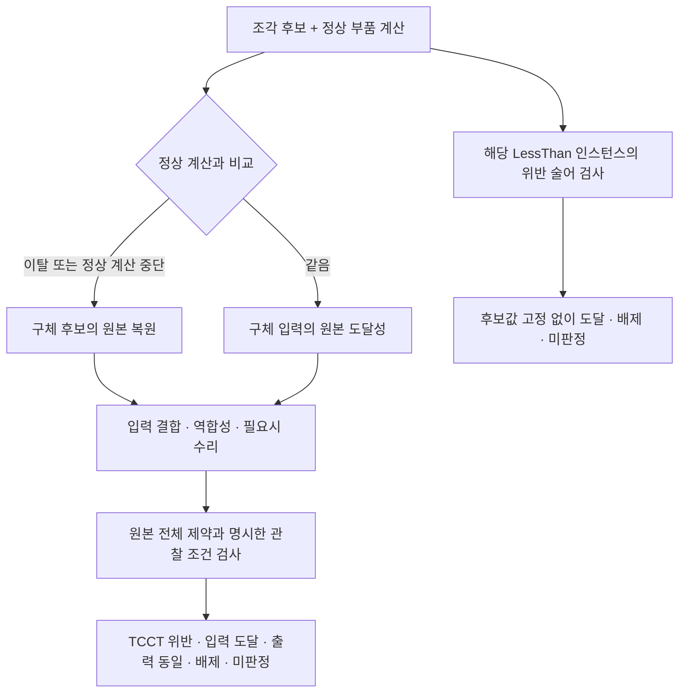

# zkfDO·zkFuzz++ 설명 초안 검토와 알고리즘 보강 v1

2026-11-05 KST. 검토 대상: [사용자 제공 초안](/Users/miiz/Downloads/zkfDO_vs_zkFuzzPP_.md). SHA-256: `df96c54f648ca5d99ce6fdcd87a08218ed2760b87142cc864bd88b99a6c51eab`.

초안, 현재 작업 트리의 구현, 보존된 결과 보고서와 실행 메타데이터, zkFuzz 원문을 대조했다. 현재 소스의 기능 설명과 과거 고정 바이너리의 실험 성과를 구분한다. 새 퍼징·J 실행은 하지 않았으며 원문과 기존 프로토콜·판정은 수정하지 않았다. 아래 수식과 의사코드는 설명용 재구성이다. 실제 후보값·witness 대신 기호를 사용한다.

## 1. 총평

**소개 자료로는 흐름이 잡혀 있지만, 교수님이 알고리즘을 이해하기에는 핵심 연산과 판정의 범위가 부족하다.** 특히 5.3의 실제 후보 추적은 유지할 만하다. 그 앞에 “무엇을 만족하는 해를 찾는가”, “어떤 변수를 고정하고 푸는가”, “해를 못 찾았을 때 왜 배제할 수 있거나 없는가”를 추가해야 한다.

가장 큰 누락은 J를 하나의 직선 흐름으로 설명한 것이다. 구현에는 **구체 후보의 원본 복원**, **정상 계산과 같은 후보의 입력 도달성**, **LessThan 의미 위반 술어의 존재성 판정**이 있다. 이들을 합쳐 “최종 출력이 다르면 L1”이라고 설명하면 실제 방법의 중요한 부분이 사라진다.

권장 발표 순서는 **문제와 판정식 → zkFuzz++ 내부 반복 → 자동 대상 구성 → J의 분기와 알고리즘 → 실제 사례 → 결과와 한계**다. 현재 초안의 성능 표는 알고리즘 설명 뒤로 옮기는 편이 질문에 잘 맞는다.

## 2. 먼저 고칠 내용

| 초안 위치·표현 | 확인 결과와 수정 방향 |
|---|---|
| §1 “`<==`를 바꾸면 제약도 같이 바뀌어 의미 없음” | zkFuzz는 **원래 제약 C를 고정하고 계산 P를 변이**한다. 강한 대입까지 변이하면 고정 C에 곧바로 걸릴 가능성이 커서 비효율적이라는 설명이 맞다. 변이 프로그램으로 검사할 C까지 함께 바꾸는 모델이 아니다. [논문 §V-B](https://arxiv.org/html/2504.11961v3#S5.SS2) |
| §0·§3 “W는 원본에서 찾았으니 바로 반례” | W도 먼저 **L0 후보**다. unused-output·가정 위반·TCCT 경로가 다르고, 원본 증거 확인·입력 조건·원인 귀속을 구분한다. 우리 평가도 W와 S+J에 같은 L1/L2 기준을 적용한다. [N5 확인 수준](/Users/miiz/Desktop/kwzzzz_zkfr/docs/n5_evaluation_protocol_v1_2026-10-06.md:73) |
| §2.2 “W와 S 차이는 첫 번째 인자 하나뿐” | 같은 엔진·GA·선택기 기본값을 사용한다는 뜻으로 한정한다. **대상별 재시작, 30초 배분, 순환 seed, J 삽입, 중단 조건, 전체 상한과 include 경로**도 다르다. 엔진 설정의 통제와 실험 전체의 동일성을 구분해야 한다. |
| §3·§5 “2,336곳 → wrapper 22개” | cold 세 seed의 보존 계획은 **호출 위치 2,336개 → 고유 wrapper 21개 + 원본 1개 = 실행 대상 22개**다. `compile_units`와 `targets`를 혼동했다. [manifest 구성](/Users/miiz/Desktop/kwzzzz_zkfr/scripts/measure_f01_discovery.py:55) |
| §5.1 “후보 파일 생기면 즉시 J” | 이 cold 실행기는 **한 퍼징 시도가 반환된 뒤** 후보 목록을 읽고 J를 동기 실행한다. 다음 시도 전에 J가 들어가는 구조이며 파일 감시로 즉시 병렬 호출하는 구조가 아니다. |
| §5.2 P3의 코드 위치와 동률 규칙 | 일반 `small_first` 계획과 cold 실행기의 재정렬을 구분한다. 초안의 이름·매개변수·id 동률 규칙은 **cold의 `order_key()`**다. [실행기](/Users/miiz/Desktop/kwzzzz_zkfr/scripts/n7_a_sj_cold_e2e_20261029.py:87) |
| §5·§6 “R1CS·SYM 모두 바이트 단위 동일” | R1CS 바이트 동일성을 검사하지만, SYM은 익명 컴포넌트 이름의 일대일 대응을 허용하는 **구조 동등성** 경로도 있다. “원본 R1CS 동일성과 신호 대응 동등성을 검증”으로 고친다. [주입 관문](/Users/miiz/Desktop/kwzzzz_zkfr/src/candidate_review/lifting/mod.rs:1044) |
| §5.4 `honest_aborted`를 출력 차이와 같은 조건으로 설명 | 비교 계산이 중단되면 정상 출력 쌍이나 `public_inputs_equal=true` 관측 자체가 없다. **출력 불일치형**과 **계산 중단형**을 별도 행으로 설명한다. `entrypoint_violation` enum과 특정 실험의 L1 채택 규칙도 구분한다. [최종 판정](/Users/miiz/Desktop/kwzzzz_zkfr/src/candidate_review/lifting/mod.rs:2460) |
| §5.4 배제 = 오류 제거 | 정확 후보값의 배제, 기준 입력을 고정한 조건부 배제, 후보값을 고정하지 않는 위반 술어 배제를 구별한다. **한 후보가 불가능해도 다른 값으로 같은 오류가 가능할 수 있다.** |
| §5.3 “클래스 4개, 각 256곳” | 클래스는 인덱스를 추상화한 경로와 입력 연결 종류로 묶고 **대표 위치**를 평가한다. 256개 모든 호출 맥락을 증명한 것으로 읽으면 안 된다. [클래스 구성](/Users/miiz/Desktop/kwzzzz_zkfr/src/candidate_review/lifting/mod.rs:1709) |
| §6 ScaleCirc “출력 유일성만” | 출력 유일성은 이 문서에서 비교하는 UNDER 판정의 속성이다. ScaleCirc 프레임워크는 다른 분석 과제에도 적용되므로 도구 전체를 이 속성 하나로 한정하지 않는다. [공식 초록](https://conf.researchr.org/details/ase-2025/ase-2025-papers/173/ScaleCirc-Scaling-the-Analysis-over-Circom-Circuits) |

### 수치와 실험 해석의 수정

| 항목 | 사용할 표현 |
|---|---|
| W 4,800초 후보 0 | **후보 파일 미관측, 운영 실패로 원장 결손**. 자식 프로세스 잔류·수동 종료가 있었으므로 정상 완료한 1,236초 실행과 같은 품질의 비교 행으로 놓지 않는다. [원본 보고](/Users/miiz/Desktop/kwzzzz_zkfr/docs/n7_a_w_long_results_2026-10-29.md:7) |
| cold 134.6/209.2/831.4초 | 원본 복사부터 준비·S·J·원본 검사까지 포함한 첫 원본 검증 반례 시간이다. **사람 검토와 수정본 원인 귀속 재생은 밖**이다. seed 02에는 다른 재생 작업과의 중첩이 있었고, 같은 seed만으로 후보가 재현되지는 않았다. “캐시 없이”는 이전 실행의 응용 캐시를 재사용하지 않았다는 뜻이며 같은 실행 안의 J 캐시는 사용한다. [cold 보고](/Users/miiz/Desktop/kwzzzz_zkfr/docs/n7_a_sj_cold_e2e_results_2026-10-29.md) |
| B “후보 76%를 증명으로 제거” | 구성 입력 탐색층에서 양 엔진 판정 완료 **27/107요청**의 반복 포함 `(요청, 대표 클래스)` **461회 중 350회** 배제다. 314회는 기준 입력 전체를 고정하지 않는 근거 유형, 36회는 기준 입력 의존 반박이다. 고유 오탐 350개·전체 B 정확도·모든 오류의 제거를 뜻하지 않는다. [집계](/Users/miiz/Desktop/kwzzzz_zkfr/docs/n6_light_tasks_2026-10-26.md:11) |
| aq-024 배제 993·미판정 345 | 초안에 정확한 집계 파일·엔진·시점·분모가 없다. 기존 검토에서는 345 근거를 확인하지 못했다. **틀렸다고 확정하지 말고 출처 확인 전 본문에서 보류**한다. [기존 교정](/Users/miiz/Desktop/kwzzzz_zkfr/docs/professor_briefing_2026-10-27_v2.md) |
| “10만~40만은 대부분 끝까지 돌고도 후보 없음” | 크기별 보고에는 `no_candidate`, 캠페인 예산 소진, 개별 시도 `timeout`이 섞여 있다. inference 등은 `T=3`이다. **상한 내 후보 미관측**으로 쓰고 종료 원인을 나눈다. “100만 이상 대부분 메모리 한도”도 6리비전 중 4개에서 메모리 한도가 관측됐으나 timeout이 함께 있음을 밝힌다. [크기별 원표](/Users/miiz/Desktop/kwzzzz_zkfr/docs/n6_a_size_cost_table_2026-10-26.md:15) |
| 0/21 대 20/21, 18개 중 각 1개 | 전자는 세 seed 합의 **리비전별 후보 관측**이고 후자는 고정 매핑의 **엄격층 L1 확인 항목**이다. 독립 프로젝트·새 취약점 수가 아니다. 규모별 표의 제약 수와 cold O0 수치도 최적화 수준을 함께 적는다. |
| 100만 이상 “엄격 0/6, 판정 대기” | 인용한 10-26 표의 엄격층은 **기준 입력 결손으로 준비 실패**한 요청들이다. 구성 입력 탐색층의 대기와 섞지 않는다. 미확인은 엔진의 unknown과도 다르다. [원표](/Users/miiz/Desktop/kwzzzz_zkfr/docs/n6_a_size_cost_table_2026-10-26.md:47) |
| zkFuzz 원문 표 | 크기별 57+7+12+2는 78인데 논문 Table IV의 총계는 79다. **원문 자체의 불일치**를 주석 처리하거나 크기별 표를 생략한다. ++의 85는 5 seed의 최대치이고 최소는 84다. [원문 Table IV](https://arxiv.org/html/2504.11961v3#S6) |

§4.3의 입력 유효성·전체 실행 비용·변이 위치 제한은 W의 어려움을 설명하는 가설이다. 이번 기록만으로 각각이 무후보 결과를 얼마나 설명하는지 분리하지 못했다. 실제 유효 입력 비율, 시도당 비용, 조건을 바꾼 기능 제거 실험 없이 “실패 원인 확정”으로 표현하지 않는다.

## 3. 교수님께 설명할 알고리즘 본문

### 3.1 먼저 계산과 제약을 분리한다

Circom 프로그램은 witness를 계산하는 절차와, 그 witness가 만족해야 하는 제약을 함께 기술한다. `<--`는 계산만 지정하고 `<==`는 계산과 등식 제약을 함께 지정한다. 따라서 정직한 생성기가 만든 값 외에 다른 값도 제약을 만족할 수 있다.

- `P`: 분석할 원본 entrypoint.
- `G_P(x)`: 입력 `x`에서 정직 계산이 만드는 witness. 계산이 중단되면 `⊥`.
- `w`: 입력·중간 신호·출력 전체를 담은 witness.
- `C_P(w)`: 원본 R1CS 전체가 만족되는지.
- `I_s(w)`, `H_s(w)`: 호출 위치 `s`의 부품 입력과 후보가 바꾼 hint 신호.
- `O(w)`: 최상위 공개 출력.

R1CS의 각 제약은 유한체 `F_p`에서 다음과 같다.

```text
C_P(w) = AND over j of [(A_j · w)(B_j · w) − (C_j · w) ≡ 0 mod p]
```

주요 출력 불일치형 질문은 “같은 구성 입력에서 비교 계산과 다른 최상위 출력을 내지만 `C_P`를 만족하는 witness가 있는가?”다. LessThan 가정 위반형은 “원본 제약을 만족하면서 특정 비교기의 정수 비교 의미가 깨지는 witness가 있는가?”다. 두 질문은 다르다.

**전체 witness를 검사한다는 것은 SNARK proof를 생성·검증했다는 뜻이 아니다.** 여기서는 원본 R1CS를 Rust 평가기와 `snarkjs wtns check`로 확인한다.

### 3.2 zkFuzz++가 담당하는 부분과 우리가 추가한 부분

zkFuzz의 탐색은 입력만 무작위로 바꾸는 일반 테스트보다 넓다. 원래 제약을 고정하고, witness 계산의 대입을 변이한 프로그램과 입력을 함께 탐색한다. 변이 실행이 제약을 얼마나 만족하는지와 원래 계산과의 불일치를 이용한다. ++의 다섯 선택기는 변이 위치와 입력 제안을 좁힌다. 이 내부 탐색은 W와 S가 공유한다. [논문 Algorithm 1·§V](https://arxiv.org/html/2504.11961v3)

로컬 기본 설정의 핵심 반복은 다음처럼 설명할 수 있다.

```text
M = witness 계산 변이체 집단
X = 입력 집단
while 제한시간과 세대 상한 안:
  기본 random 모드에서는 X를 입력 분포에서 다시 뽑는다.
  M을 이전 점수에 따라 선택·교차·변이한다.
  변이 없는 원래 계산도 시험 대상에 넣는다.
  zero-division 등 선택기로 일부 입력을 보정한다.
  각 m과 x에 대해:
    원래 계산 P(x)의 성공/중단과 변이 계산 P_m(x)를 관찰한다.
    P_m(x)의 값으로 고정된 원본 제약 C의 오차를 평가한다.
    제약 만족 + 출력 차이/정상 계산 중단이면 해당 후보를 반환한다.
    정상 실행 성공 + 원래 제약 불만족은 별도 over-constrained 후보다.
  후보가 없으면 점수를 이용해 다음 집단을 만든다.
```

기본 제약 오차 기반 점수의 핵심은 `score(m)=max_x(-Σ_j error(C_j,P_m(x)))`다. 단, 제약을 만족하더라도 정상 계산이 성공하고 최종 출력이 같으면 반례가 아니므로 점수를 `-p`로 낮춘다. **제약 오차 합 0과 최종 fitness 0을 구분해야 한다.** 구현은 오라클 조건을 만족한 후보에 최종 점수 0을 주며, 그 후보의 프로젝트 영향은 별도 검토 대상이다. 기본 집단 크기는 프로그램·입력 각각 30이고 최대 500세대지만, 원래 계산의 추가·조기 종료가 있어 한 세대를 정확히 900회 시험이라고 고정하지 않는다. 입력은 기본 `random` 모드에서 재표본화하므로 항상 입력까지 GA로 진화한다고도 쓰지 않는다.

근거: [설정](/Users/miiz/Desktop/kwzzzz_zkfr/.external/zkFuzz/src/mutator/mutation_config.rs:51), [세대 반복](/Users/miiz/Desktop/kwzzzz_zkfr/.external/zkFuzz/src/mutator/mutation_test.rs:289), [fitness·오라클](/Users/miiz/Desktop/kwzzzz_zkfr/.external/zkFuzz/src/mutator/mutation_test_trace_fitness_fn.rs:67). 별도 unused-output 및 LessThan 조건 검사도 있어 모든 후보가 이 출력 불일치 경로에서 나오는 것은 아니다.

| ++ 선택기 | 로컬 기본 동작·근거 |
|---|---|
| Weak Assignment | `<--`를 변이 후보로 선택. [mutation_test.rs](/Users/miiz/Desktop/kwzzzz_zkfr/.external/zkFuzz/src/mutator/mutation_test.rs:186) |
| White List | 기본 `IsZero`, `Num2Bits` 내부를 제외. [main.rs](/Users/miiz/Desktop/kwzzzz_zkfr/.external/zkFuzz/src/main.rs:129) |
| Zero-Division | 해당 입력 보정 시도 확률 기본 0.2. [mutation_config.rs](/Users/miiz/Desktop/kwzzzz_zkfr/.external/zkFuzz/src/mutator/mutation_config.rs:80) |
| Invalid Array Subscript | 실패 반복 시 입력 범위를 조정하는 경로 활성. [mutation_test.rs](/Users/miiz/Desktop/kwzzzz_zkfr/.external/zkFuzz/src/mutator/mutation_test.rs:364) |
| Hash-Check | 런타임 입력 보정 경로 활성. [mutation_test.rs](/Users/miiz/Desktop/kwzzzz_zkfr/.external/zkFuzz/src/mutator/mutation_test.rs:217) |

이 확인은 “++의 5개 선택기가 활성화된 같은 엔진 설정”을 뒷받침한다. 논문의 모든 하이퍼파라미터와 실험 환경을 재현했다는 뜻은 아니다.

우리 쪽의 추가 질문은 다음과 같다.

```text
W: 원본 P를 zkFuzz++에 준다.
S: 원본의 구체 템플릿 T(θ)를 새 main으로 만들어 같은 엔진에 준다.
J: T(θ)의 후보가 원본 P의 실제 호출 위치 s에서도 가능한지 복원·검사한다.
```

S는 부품 경계 입력을 직접 탐색하므로 전체 앞단 계산을 매번 실행하지 않는다. 대신 호출자가 원래 강제하던 범위·상수·연결 관계가 wrapper 밖으로 사라진다. **J는 그 누락된 맥락을 원본 제약과 실제 전체 witness로 되돌려 확인하는 단계**다. zkFuzz++의 선택기와 조각화는 함께 쓸 수 있다.

### 3.3 자동 대상 구성: 무엇을 어떻게 “나누는가”

임의의 R1CS를 서로 겹치지 않는 조각으로 자르는 방식이 아니다. **원본에 실제로 등장하는 템플릿의 구체 인스턴스를 독립 main으로 다시 만든다.** 부모 wrapper 안에는 자식 계산도 들어갈 수 있으므로 대상끼리 겹칠 수 있다.

```text
DiscoverAndPrepare(P):
  원본 include와 템플릿 선언·호출 구조를 조사한다.
  진단 소스 사본에 템플릿 인자 값을 잡는 캡처 제약을 넣는다.
  Circom O0 컴파일 결과의 R1CS/SYM에서 실제 인자·호출 경로를 읽는다.
  정의 위치·구체 인자·맥락을 보존한 발견 기록을 만든다.
  같은 컴파일 단위를 합치되, 원본 호출 위치의 대응 목록은 남긴다.
  원본 템플릿을 include하는 독립 wrapper를 만든다.
  지원 여부 검사와 컴파일을 통과한 대상을 계획에 넣는다.
  준비 실패·미지원도 분모와 사유에 남긴다.
```

핵심은 매개변수 표현식을 별도 해석기가 추정하는 대신 **Circom이 계산한 구체 값**을 읽는 것이다. 캡처 제약을 넣은 사본은 발견용이다. 퍼징 wrapper는 원본 소스를 사용하고, 마지막 J도 원본 제약을 기준으로 한다.

이는 runtime 입력을 witness 실행으로 알아내는 절차가 아니다. 템플릿 ID·컴파일 시 상수 인자·배열 인덱스/원소를 캡처 wire에 연결한 등식에서 값을 읽는다. 배열 인자는 shape와 값의 해시로 식별한다. 실제 컴파일 재사용 키에는 wrapper 내용 외에 include 의존 경로·내용 해시, 미해결 include, compiler·설정·timeout도 들어간다. **컴파일의 동일성은 호출 맥락의 동일성을 뜻하지 않으므로** 호출 위치와 부모·자식 관계는 별도로 보존한다. [캡처 구현](/Users/miiz/Desktop/kwzzzz_zkfr/src/instance_capture.rs:945), [컴파일 키](/Users/miiz/Desktop/kwzzzz_zkfr/src/targets.rs:2757).

단순한 대상은 `include ...; component main = T(θ);` 형태다. 태그 입력 등은 별도 지원 경로가 필요하므로 이 한 줄이 모든 Circom 구문을 처리한다고 설명하지 않는다. inference cold의 실행 대상은 wrapper 21개와 원본 1개다.

2,336개 발견 위치·21개 컴파일 단위의 직접 근거는 [seed 01 발견 기록](/Users/miiz/Desktop/kwzzzz_zkfr/runs/n7-a-sj-cold-2026-10-29-v2/2026100601/tree/input/discovery/b84f2974-89af-4716-a8e5-fc722ecb67fb/discovery.json), [seed 02 발견 기록](/Users/miiz/Desktop/kwzzzz_zkfr/runs/n7-a-sj-cold-2026-10-29-v2/2026100602/tree/input/discovery/9073c193-ac50-4365-843b-70320ebce5c7/discovery.json), [seed 03 발견 기록](/Users/miiz/Desktop/kwzzzz_zkfr/runs/n7-a-sj-cold-2026-10-29-v2/2026100603/tree/input/discovery/d7fe5a27-bde5-42c6-ba26-02bac178e78f/discovery.json)이다. 각 seed 폴더의 `manifest.json`·`split-plan.json`에서 원본을 더한 22개도 확인했다.

근거: [instance_capture.rs](/Users/miiz/Desktop/kwzzzz_zkfr/src/instance_capture.rs), [targets.rs](/Users/miiz/Desktop/kwzzzz_zkfr/src/targets.rs), [corpus.rs](/Users/miiz/Desktop/kwzzzz_zkfr/src/corpus.rs), [manifest 구성](/Users/miiz/Desktop/kwzzzz_zkfr/scripts/measure_f01_discovery.py:55).

### 3.4 실행 순서는 별도의 정책이다

현재 설명 대상인 cold 실행은 준비된 제약 수를 이용한 small-first 순서다. 각 시도에 최대 30초를 주고, 한 바퀴 뒤 seed를 증가시키며, 시도가 반환되면 새 후보를 J에 넘긴다. 채택 기준을 만족하는 첫 원본 반례가 생기거나 전체 시간 상한에 닿으면 멈춘다.

이 실행의 J 정상 기준 입력은 기존 `BASE_INPUT` 파일로 제공됐다. **원본 소스만 주면 정상 입력까지 자동 생성되는 시스템은 아니다.** 또 정렬용 계획에서 원본 크기는 기본 최적화 컴파일의 196,096제약이고 최종 검증의 O0는 401,664제약이다. 같은 크기 필드로 혼합하면 안 된다. [입력·준비](/Users/miiz/Desktop/kwzzzz_zkfr/scripts/n7_a_sj_cold_e2e_20261029.py:162), [manifest 컴파일 옵션](/Users/miiz/Desktop/kwzzzz_zkfr/scripts/measure_f01_discovery.py:65).

이 정책은 zkFuzz++의 GA 내부 선택과 다르다. **한 wrapper 안의 변이 선택**과 **어느 wrapper에 다음 시간을 줄지**를 서로 다른 층으로 그려야 한다. 랭킹 구현이 있다는 사실과 현재 결과가 학습형·적응형 랭킹의 효과라는 주장은 구분한다. 이 cold 결과는 small-first 정책의 관측이다.

### 3.5 J의 첫 분기: 무엇을 되살리려는 후보인가

J는 wrapper의 같은 입력에서 원래 계산을 재실행하여 후보 witness와 비교한다.

| 분기 | 이후 질문 |
|---|---|
| 정직한 부품 계산과 다른 hint 신호가 있음 | 그 후보 입력·hint 값을 원본 호출 위치에 실으면서 원본 최상위 TCCT 위반까지 만들 수 있는가? |
| 정직한 부품 계산 자체가 중단됨 | TCCT 후보 경로로 처리하며, 비교 가능한 이탈 신호만 고르는 대신 사용 가능한 hint 대입들을 주입 대상으로 삼을 수 있다. |
| 후보가 정직한 부품 계산과 같음 | 후보의 부품 입력이 원본 맥락에서 나올 수 있는가? 이것만으로 최상위 출력 차이를 뜻하지 않는다. |
| 알려진 LessThan 조건 위반을 확인 | 후보값 자체와 별도로, 그 원본 인스턴스에서 **어떤 값으로든** 같은 의미 위반이 가능한가? |

이 표의 검사는 서로 완전히 배타적인 세 갈래가 아니다. 정직 계산과 같은 후보나 정직 계산 중단 후보에서 깨진 비교기 위치를 특정하지 못하면, wrapper의 해석 가능한 LessThan 인스턴스 전체를 술어 검사 대상으로 삼는 경로도 있다. [분류와 대상 설정](/Users/miiz/Desktop/kwzzzz_zkfr/src/candidate_review/lifting/mod.rs:796).



J는 해당 템플릿의 호출 위치를 찾고, 인덱스를 추상화한 경로 및 입력 연결 종류로 클래스를 만든다. 클래스별 대표를 평가하는 것은 탐색 비용을 줄이는 선택이다. 대표 한 곳의 불가능을 모든 반복 호출의 불가능으로 일반화하려면 추가 동등성 근거가 필요하다.

### 3.6 후보 주입과 제약 보존

구체 후보가 부품 입력 `u_c`와 hint 값 `h_c`를 제시했다고 하자. J는 후보와 다른 정직 계산의 `<--` 위치를 찾아 다음 형태로 소스 사본의 계산만 바꾼다.

```text
hint <-- (인스턴스 입력 = u_c && 필요시 대상 배열 인덱스 일치)
         ? h_c : 원래 계산식;
```

수정 사본을 다시 컴파일하고 원본 R1CS와 같은지, SYM의 신호 대응이 같은지 확인한다. 코드에 `<--`만 썼다는 사실에만 의존하지 않는다. guard가 입력값 기반이므로 다른 호출 위치에서도 발동할 수 있어 **목표 위치에 실제 주입됐는지와 다른 이탈 위치 수**도 확인한다.

여기서 원본 제약을 보존하는 이유는 명확하다. 제약까지 약화한 뒤 통과하는 witness는 원본 반례가 아니기 때문이다. 계측·진단 사본과 최종 증거를 만드는 사본을 구분해야 한다.

### 3.7 입력 역합성: 부품의 입력을 main 입력으로 어떻게 만드는가

호출 위치의 각 입력은 다음처럼 처리한다.

1. 원본 최상위 입력과 같은 wire이거나 O0 등식으로 같은 값을 갖는 등가류이면 해당 JSON 잎을 후보값으로 대입한다.
2. 상수면 후보값과 비교한다. 다르면 그 정확 후보를 배제한다.
3. 둘 이상의 연결이 같은 wire에 서로 다른 후보값을 요구하면 결합 충돌이다.
4. 앞단 계산의 결과면, 그 값을 만드는 최상위 입력을 합성한다.

**(a) 제약 그래프를 통한 역전파.** wire와 해당 wire를 쓰는 제약의 인접 목록을 만든다. 목표 중간 wire에서 변경 가능한 main 입력까지 BFS로 짧은 경로를 찾는다. 경로 밖 값은 현재 witness의 값으로 두고, 한 단계에서 다음 wire `z`에 관한 잔차 `f(z)`가 일차식인지 검사한다. R1CS가 이차 이하이므로 `f(0), f(1), f(2)`로 이차항 존재를 확인할 수 있다. 일차식 `a·z+b=0`, `a≠0`이면 `z=−b·a⁻¹ mod p`로 제안한다. 이 경로는 일반 이차 방정식을 전부 푸는 solver가 아니다.

설명용 예로 원본 연결이 `u=3x+2 mod p`, 목표가 `u=t`이면 `x=(t−2)·3⁻¹ mod p`를 제안한다. **정수 나눗셈이 아니라 유한체 역원**이다. 나머지 범위 검사와 다른 연결도 있으므로 대입만으로 도달을 선언할 수 없다.

매 제안 뒤 전체 witness 생성기를 재실행하고 목표값이 실제로 나오는지 확인한다. 여러 부품 입력을 동시에 만족해야 한다. 코드의 `public_inputs()`라는 보조 함수 이름과 달리 이 경로의 변경 가능 main 입력에는 사설 입력도 포함된다. 기본 제한은 목표당 최대 6경로, 한 클래스 역합성에서 총 12시도·최대 3라운드이며 실행 옵션과 버전을 함께 기록한다.

**(b) 제한된 국소 SMT 풀이.** 역전파로 충분하지 않으면 목표 주변 원본 제약을 모아 `0≤w_i<p`인 정수와 모듈러 식으로 Z3에 전달한다. SAT 모델은 입력 또는 hint의 **제안**이며, 전체 재실행과 최종 검사를 통과해야 도달이다. 설명할 때 다음 절의 배제용 원뿔과 수리용 원뿔을 구분해야 한다.

기본 closed-cone 상한은 깊이 6·미지수 300·제약 600, joint 풀이 20초다. 분기 풀이에는 5초, 후보 내 여러 위치가 공유하는 배제 sweep에는 20초 제한이 있다. 연결이 많은 hub에서 확장을 멈추더라도 배제 질의의 그 wire는 자유변수로 남긴다. 이 제한은 완전성보다 실행 가능성을 택한 것이며, 도달과 배제 모두 끝까지 결정하는 알고리즘이라는 보장은 없다.

근거: [synth.rs](/Users/miiz/Desktop/kwzzzz_zkfr/src/candidate_review/lifting/synth.rs:27), [일차식 역산](/Users/miiz/Desktop/kwzzzz_zkfr/src/candidate_review/lifting/synth.rs:148), [재실행 채택](/Users/miiz/Desktop/kwzzzz_zkfr/src/candidate_review/lifting/mod.rs:2990).

### 3.8 UNSAT의 의미: 어떤 실패가 진짜 배제인가

정확 후보가 요구하는 조건을 `E_c(w)`라 하자. 예를 들어 그 호출 위치의 입력과 변이 hint가 후보값이라는 등식이다. 다음이 UNSAT이면 원본에서 그 후보는 불가능하다.

```text
C_P(w) ∧ E_c(w)
```

실제로 모든 제약을 한꺼번에 풀 필요는 없다. 원본 제약의 부분집합 `C_sub`과 원본이 함의하는 범위 사실 `R`만으로도

```text
C_sub(w) ∧ R(w) ∧ E_c(w) = UNSAT
```

이면 전체 원본에도 해가 없다. **후보가 정하지 않은 자유변수를 임의의 기준값으로 추가 고정하지 않았다는 점**이 중요하다. 이름이 “국소”라서 건전한 것이 아니라, 전체 해가 이 부분 질의도 만족해야 하기 때문에 배제가 성립한다.

반면 수리·제안 탐색에서 다른 wire를 기준 witness 값에 고정한 채 UNSAT이면 그 주변 상태로 고칠 수 없다는 뜻뿐이다. 다른 입력·다른 주변 값의 가능성은 남는다. 따라서 수리 실패·timeout·예산 소진은 배제가 아니라 unknown이다.

비트 분해는 boolean 비트들과 선형 재조합으로 wire의 구간을 도출한다. 후보값이 이 구간 밖이면 solver의 모델 탐색 없이도 모순을 얻는다. 구간을 정수 범위로 해석할 때는 유한체 wraparound를 피하는 구현상의 조건을 유지해야 한다.

`local_constraint_refutation`은 별도로 읽는다. 구성한 **전체 main 입력을 고정**한 반박일 수 있으므로 “모든 원본 입력에서 불가능”으로 바꾸지 않는다. 소스의 `synth.rs` 첫 주석 일부보다 실제 closed-cone 구현과 결과의 근거 필드를 우선해 설명한다.

근거: [배제 원뿔](/Users/miiz/Desktop/kwzzzz_zkfr/src/candidate_review/lifting/synth.rs:186), [입력 의존성 감사](/Users/miiz/Desktop/kwzzzz_zkfr/docs/n6_light_tasks_2026-10-26.md:49), [bitrange.rs](/Users/miiz/Desktop/kwzzzz_zkfr/src/candidate_review/lifting/bitrange.rs).

### 3.9 witness 수리: 생성기가 멈춰도 왜 반례가 가능할까

제약에 맞는 witness가 존재하더라도 정해진 계산 절차가 그 witness를 만들지 못하고 중간 assert에서 멈출 수 있다. J는 이때 제약을 만족하는 다른 hint 값을 찾는다.

```text
Repair(input, required_candidate_or_predicate):
  진단 사본에서 중단 문장을 제한적으로 제거하여 끝까지 값을 관찰한다.
  진단 witness를 신호 이름으로 원본 O0 wire에 대응시킨다.
  원본 제약 전체를 검사하여 실제 실패 제약과 인스턴스를 특정한다.
  실패 인스턴스·입력 연결·필요한 상류 경로로 작은 수리 영역을 만든다.
  요구하는 후보값/술어를 유지하고, 허용한 hint/main 입력을 미지수로 둔다.
  영역 밖 값은 현재 값으로 고정해 Z3로 대안을 제안한다.
  바뀐 hint를 <-- 계산에 주입하고 제약 보존을 다시 확인한다.
  전체 witness를 재생성하고 원본 전체 제약으로 확인한다.
  실패하면 제한 내에서 반복하고, 소진하면 unknown이다.
```

**assert·제약을 제거한 진단 사본의 witness로 성공을 선언하지 않는다.** 진단 사본은 위치 파악용이다. 최종 증거는 제약 보존 관문을 통과한 생성기와 원본 R1CS 검사에 의존한다. 수리 영역의 UNSAT 자체는 배제로 쓰지 않는다.

또 수리 후 비교 대상은 항상 손대지 않은 원본 생성기인 것은 아니다. 후보 자체의 hint 주입은 빼고 외부 수리만 남긴 **비교용 생성기**를 구성하는 경로가 있다. 그러므로 실제 결과를 설명할 때 `comparator` 사용 여부와 수리 의존성을 밝혀야 한다. 출력 차이가 생겼다는 사실에서 처음 후보를 낸 템플릿의 독립 원인까지 자동 귀속할 수 없는 이유이기도 하다.

근거: [repair.rs 설계](/Users/miiz/Desktop/kwzzzz_zkfr/src/candidate_review/lifting/repair.rs:1), [비교 생성기](/Users/miiz/Desktop/kwzzzz_zkfr/src/candidate_review/lifting/repair.rs:1349), [재생성](/Users/miiz/Desktop/kwzzzz_zkfr/src/candidate_review/lifting/mod.rs:2364).

### 3.10 LessThan 술어: 정확 후보와 오류 조건을 분리한다

`LessThan`의 입력값을 유한체 원소의 정수 표현으로 읽었을 때, 원본 인스턴스 `s`의 위반 술어는 다음과 같다.

```text
phi_s(w) := out_s(w) != (in0_s(w) < in1_s(w) ? 1 : 0)
```

구체 후보 질의는 `E_c(w)`를 고정한다. 술어 질의는 후보값을 고정하지 않고 다음을 묻는다.

```text
존재하는가 w: C_P(w) ∧ phi_s(w)
```

- 전체 제약을 두 검사기로 통과하고 위반 술어 `phi_s`가 참인 witness를 얻으면 `assumption_violation_reachable`.
- 자유변수를 임의로 고정하지 않은 부분 제약·함의 범위 사실과 술어가 UNSAT이면 `assumption_excluded_in_context`.
- 그 밖에는 unknown.

이 분기가 있어 “처음 후보는 원본 상수와 충돌하지만 다른 값으로 같은 비교 오류가 가능하다”는 상황을 구별한다. 구현은 모든 버그의 의미를 자동 추론하는 범용 술어 시스템이 아니다. **zkFuzz의 알려진 LessThan 조건을 복원하는 명시적 경로**다.

술어는 후보 한 개보다 `(entrypoint, instance)`에 속하므로 검사한 증거를 후속 요청에 공유할 수 있다. 실제 저장 키에는 원본·입력·도구 등 문맥 식별이 들어가며, 캐시 재사용을 새로운 독립 발견으로 세지 않는다. 새로 도달시킨 입력이 기준 입력의 공개 값을 바꿨는지도 `reach_inputs`로 구분한다. “두 witness 사이 공개 입력 동일”과 “원래 배포 환경의 공개 값 그대로”는 별개의 비교다.

근거: [predicate.rs](/Users/miiz/Desktop/kwzzzz_zkfr/src/candidate_review/lifting/predicate.rs:1), [L-05 결과](/Users/miiz/Desktop/kwzzzz_zkfr/docs/lifting_l05_results_2026-10-03.md), [L-07 결과](/Users/miiz/Desktop/kwzzzz_zkfr/docs/lifting_l07_results_2026-10-06.md).

### 3.11 최종 판정과 결과 단위

| 결과 | 보장하는 내용 | 자동으로 보장하지 않는 내용 |
|---|---|---|
| `entrypoint_violation/output_differs` | 원본 제약을 통과한 이탈 witness, 목표 후보 주입, 비교 witness와 공개 입력 일치·최상위 출력 차이 | 최초 후보 템플릿의 독립 원인, 배포 환경 공격 가능성 |
| `entrypoint_violation/honest_aborted` | 비교 계산은 중단하지만 목표 후보를 담은 이탈 witness는 원본 제약을 만족 | 정상 출력과 이탈 출력의 쌍, 모든 평가에서 같은 L1 채택 |
| `assumption_input_reachable` | 구체 부품 입력의 원본 도달 | 위반 술어 성립이나 최상위 출력 변화 |
| `assumption_violation_reachable` | 특정 인스턴스의 명시한 의미 위반이 원본 witness에서 성립 | 모든 경우의 최상위 출력 변화 |
| `compatible_no_top_violation_observed` | 주입·제약 만족은 가능하지만 이번 비교에서 최상위 출력 차이 없음 | 회로 안전성 |
| 배제 | 기록된 질의·고정값·근거 범위 안에서 불가능 | 다른 후보나 모든 입력의 안전성 |
| unknown | 예산·지원 범위·생성·검사 문제 등으로 결론 없음 | 음성 판정 |

일반 J의 기본 두 검사 대상은 이탈 witness다. 특정 실험이 정상·이탈 **두 witness 모두**를 별도로 재검증했다면 그 영수증을 연결한다. 모든 J 호출이 두 witness의 동일한 추가 검사를 했다고 일반화하지 않는다.

후보 → 요청 → 대표 클래스 → 원본 인스턴스 → 리비전 → 고유 원인은 서로 다른 집계 단위다. L1은 원본 수준 확인이고 L2는 원인 귀속이다. 동일 소스 결함이 많은 wrapper·위치·seed에서 반복 검출될 수 있으므로 검출 후보 수를 버그 수로 쓰지 않는다.

## 4. zkFuzz++와의 차이를 설명할 문장

> zkFuzz++는 제출된 회로의 제약을 고정하고 witness 계산과 입력을 탐색하는 엔진입니다. 우리는 그 엔진을 사용하면서 탐색 대상을 원본의 구체 템플릿 인스턴스로 자동 구성합니다. 조각에서는 내부 입력을 직접 탐색할 수 있지만 호출자 제약을 잃기 때문에, J가 호출 위치의 입력 관계를 복원하고 필요한 main 입력과 hint 값을 찾습니다. 이후 원본 제약을 그대로 만족하는 전체 witness와 명시한 위반을 확인합니다. 정확 후보 하나가 불가능한지와 LessThan 위반 자체가 불가능한지도 별도로 판단합니다.

이 문장은 **구현상 차이**를 설명한다. 분할과 반례 전파 자체는 ScaleCirc·Picus에, 격리 퍼징 뒤 호출자 도달성 복원은 Wildfire 등의 선행에 있다. ScaleCirc의 직접 입력 연결 빠른 경로가 제한돼 있다는 사실을 전체 backend의 능력 부재로 바꾸면 안 된다. 남은 비교 질문은 같은 속성·입력 계약·총비용에서 어떤 미판정을 더 해결하고 어떤 원본 반례를 더 빨리 얻는가다. [선행 원문 대조표](/Users/miiz/Desktop/kwzzzz_zkfr/docs/related_work_matrix_2026-10-29_v1.md), [ScaleCirc 상세 대조](/Users/miiz/Desktop/kwzzzz_zkfr/docs/scalecirc_primary_comparison_2026-10-28.md).

## 5. 실제 사례 슬라이드에 붙일 네 가지 질문

초안 5.3의 단계별 사례 옆에 다음을 표시하면 알고리즘 설명이 된다.

1. **S가 정한 것은 무엇인가?** 부품 입력, 바뀐 hint, 위반 종류를 구분한다.
2. **J가 새로 구한 것은 무엇인가?** main 입력, 중간값 도달 경로, 추가 수리 hint를 구분한다.
3. **각 단계의 확인 조건은 무엇인가?** 목표값 재현 → 제약 보존 → 원본 전체 제약 → 위반 관찰을 표시한다.
4. **어느 단계까지 결론인가?** 후보 발생 위치, 원본 L1, 수정 대조를 통한 원인 귀속을 다른 칸으로 둔다.

간단한 기능 제거 대조도 유용하다. 역합성 없이/있이, 수리 없이/있이, 정확 후보만/술어까지의 차이를 **동일 대상·동일 예산**에서 비교하면 각 연산이 필요한 이유를 보일 수 있다. 기존 L-01/L-02 비교는 해당 개발 자료에서의 기능 효과로 소개하되 독립 평가나 모든 사례의 일반적 향상으로 확대하지 않는다.

## 6. 버전과 현재 구현에 대한 마지막 주석

초안 날짜는 11-05지만 주요 성능 수치는 10-29 cold 실행이다. 현재 작업 트리의 J v2.4는 전체 SYM 검사와 전체 제약 검사를 유지하면서 파싱·산술·제약 검사 병렬화를 개선한 별도 개발 버전이다. `--j-jobs`는 합성 전략의 병렬 탐색 옵션이 아니다. 14개 A 요청의 판정·근거 동일성과 절전 없는 13요청의 비용 감소가 보고됐지만, 이를 과거 cold 실행의 시간이나 N5 성과로 소급하지 않는다. [v2.4 보고](/Users/miiz/Desktop/kwzzzz_zkfr/docs/j_speed_2026-11-03.md).

교수님 자료에는 **설명하는 알고리즘 버전, 성능을 잰 바이너리·설정, 자료의 개발/평가 층**을 한 줄로 붙이면 된다. 알고리즘 핵심을 설명하는 데 운영 최적화 이력 전체를 본문에 넣을 필요는 없다.
